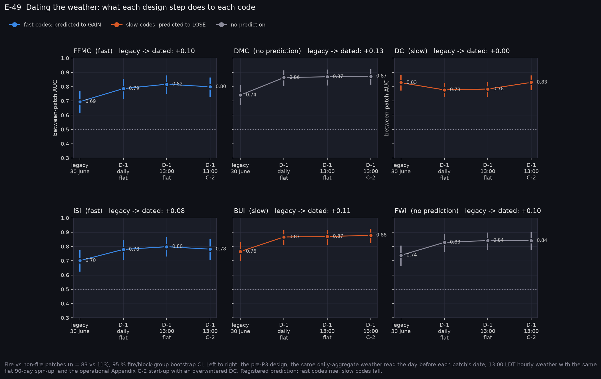
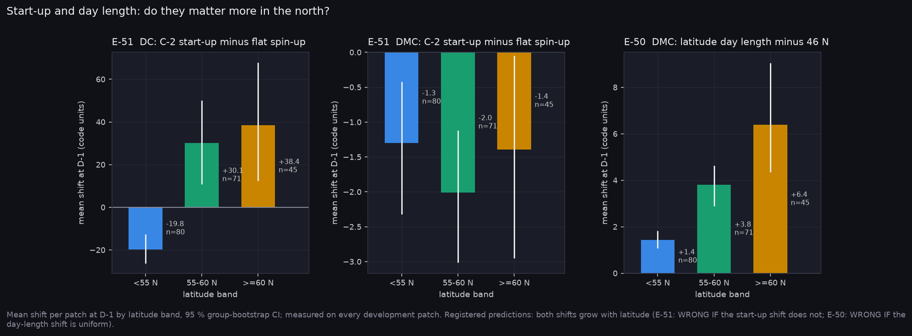
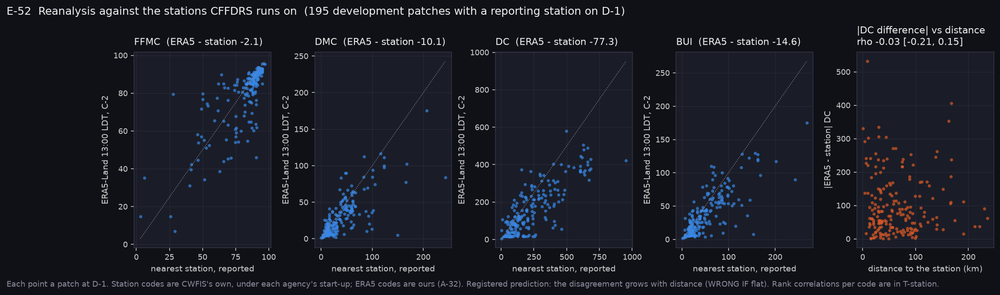
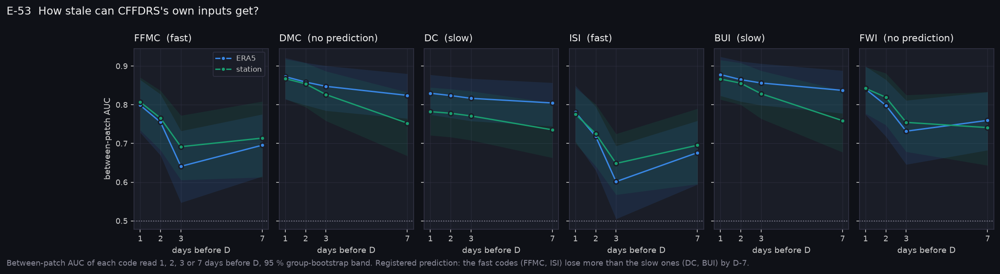
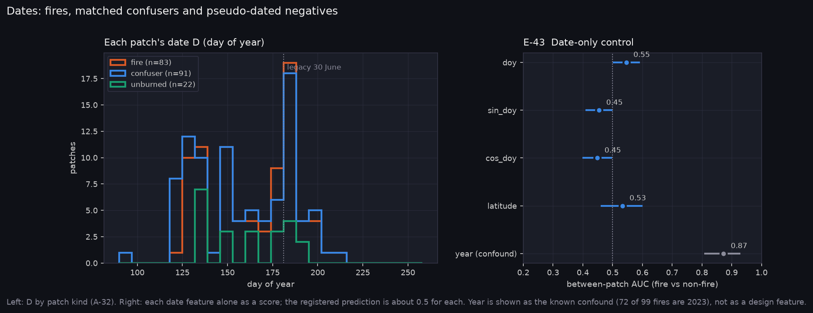
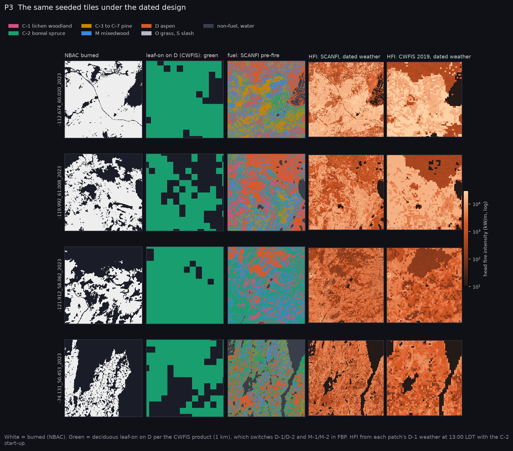

# P3: The dated design (2026-10-24)

P3 dated every patch and rebuilt its weather the way CFFDRS defines it:

- **Weather:** ERA5-Land read at 13:00 LDT on the day before the patch's date D, with the GLC-X-42 Appendix C-2 start-up and an overwintered DC.
- **Leaf state:** read on D from the CWFIS green-up product.
- **Second weather source:** the nearest CWFIS station's reported codes.
- **R0:** re-scored on 196 development patches (83 fire). The 35 frozen test patches were not read.

Your decisions applied (A-32):

- **Fire date:** the earliest of the NBAC hotspot and agency start dates.
- **Overwintering:** the `cffdrs` coefficients (a = b = 0.75).
- **Weather source:** station weather run as a second "cffdrs" source.
- **Scope:** the Sentinel-2 snow-off and green-up estimators moved to P6.

The five predictions (E-49 to E-53) were registered in commit `55607c6`, before any P3 number existed. E-43 was registered in P0.

**At a glance:** [experiments.md](experiments.md). Tables: [tables.md](tables.md).

## Verdicts

| | Prediction | Verdict |
|---|---|---|
| E-49 | Dating raises the fast codes (FFMC, ISI) and lowers the slow ones (DC, BUI) | **REFUTED**: it is the other way round once the year is controlled |
| E-50 | Latitude-correct day length shifts DMC more in the north | **SUPPORTED**: the shift is large; the skill change is not |
| E-51 | The operational start-up shifts DC and DMC more in the north | **MIXED**: DC yes (and adds skill there); DMC no |
| E-52 | Station ≥ ERA5, and their disagreement grows with station distance | **REFUTED**: the disagreement is flat with distance; ERA5 ranks as well |
| E-53 | Fast codes go stale faster than slow ones | **SUPPORTED** with ERA5; the station series is less clear |
| E-43 | Date features alone sit near chance | **SUPPORTED** (about 0.55); the year is the confound |

## What P3 found

### 1. Dating CFFDRS helps, and it helps through the slow codes (E-49)



**Across all patches**, every code except DC gains between-patch AUC when the weather is read on D−1 instead of 30 June:

| Code | Legacy | Dated |
|---|---|---|
| FFMC | 0.695 | 0.799 |
| ISI | 0.701 | 0.781 |
| DMC | 0.741 | 0.873 |
| BUI | 0.765 | 0.878 |
| FWI | 0.738 | 0.841 |

Almost all of the gain comes from the first step, putting the weather on the right day. Switching from daily aggregates to 13:00 LDT adds 0.01–0.03. The C-2 start-up mostly moves DC: dating alone drops it from 0.83 to 0.78, and the start-up with overwintering brings it back to 0.83.

**The year is the trap.** Year alone separates fire from non-fire at AUC 0.87, because 58 of the 83 development fire patches are from 2023. Counting only fire/non-fire pairs from the same year gives a different picture:

| Code | Legacy, within year | Dated, within year |
|---|---|---|
| FFMC | 0.730 | 0.717 |
| ISI | 0.727 | 0.721 |
| DMC | 0.673 | **0.839** |
| BUI | 0.691 | **0.845** |
| DC | 0.743 | **0.827** |
| FWI | 0.746 | 0.810 |

The fast codes' gain across years was the 2023 effect. Within a year, dating does nothing for them. The slow codes gain about 0.10–0.15 and keep it. So the prediction had the codes backwards, and E-49 is refuted. The within-year comparison rests on 721 pairs, most of them from 2023's 58 fires against its 7 non-fire patches, so the intervals are wide (in `tables.md`). The direction is consistent across the slow codes.

**What it means.** The weather information that separates a fire patch from a non-fire patch in the same year is accumulated drying (DMC, BUI, DC on D−1). It is not the day's fine-fuel state. That is good news for a satellite: imagery can see the slow, accumulated signal, and it cannot see yesterday's afternoon humidity.

### 2. Start-up and day length matter in the north, in different ways (E-51, E-50)



**Start-up (E-51), DC:**

| Latitude band | Change in DC (start-up minus flat spin-up) | Between-patch AUC of DC |
|---|---|---|
| Below 55° N | −20 | 0.80 → 0.80 |
| 55–60° N | +30 | 0.78 → 0.82 |
| 60° N and above | +38 | 0.77 → **0.91** |

In the south, wet winters refill the overwintered DC to 15, and the season starts after the flat spin-up would have. In the north, dry winters carry last autumn's deficit into spring. The DC gain at 60° N and above rests on 19 fire patches. DMC barely moves (−1.3 to −2.0 in every band), so the DMC half of the prediction failed. Hence MIXED.

**Day length (E-50).** Latitude-correct day length raises DMC by 1.4, 3.8 and 6.4 across the three bands, as predicted. But between-patch AUC moves by 0.006 at most. The 46° N table under-dries northern duff by about 6 DMC points by D−1, and every patch in a band is shifted alike, so the ranking survives. Under unlearned CFFDRS, G5 is a calibration gap, not a skill gap. It may still matter where an absolute threshold is applied, for example the GLC-X-42 classes.

**Mechanism note.** ERA5-Land melts snow late in the boreal forest; it put snow-off at 17 May 2021 at a 55° N site. A late start-up lowers DC, and that bias is the snow-off slot's opening for imagery (E-18, P6).

### 3. ERA5 stands in for the stations, and distance does not matter (E-52)



On the 195 patches with a CWFIS station reporting on D−1 (median distance 56 km), ERA5 at 13:00 LDT ranks fire against non-fire about as well as the stations' own reported codes:

| Code | ERA5 | Station |
|---|---|---|
| FFMC | 0.80 | 0.81 |
| BUI | 0.88 | 0.87 |
| FWI | 0.84 | 0.84 |
| DC | 0.83 | 0.78 |

The same holds through FBP: patch-mean intensity scores 0.863 with ERA5 and 0.848 with station weather.

**Systematic offset.** ERA5 runs lower than the stations: DC by 77 points and BUI by 15. That is the agencies' own start-up practice and station siting against ours, and it does not hurt the ranking.

**The registered mechanism fails.** The disagreement between the two sources does not grow with distance to the station: ρ is between −0.03 and +0.05 for every code, and every interval spans zero. This is E-17's premise, that weather error grows away from stations and so imagery should be worth most there. The codes give it no support. E-17 is now at risk before it runs.

### 4. A week-old drought code is still a drought code (E-53)



Change in between-patch AUC from D−1 to D−7:

| Code | ERA5 | Station |
|---|---|---|
| FFMC | −0.10 | −0.09 |
| ISI | −0.11 | −0.08 |
| DC | −0.03 | −0.05 |
| BUI | −0.04 | **−0.11** |
| DMC | −0.05 | −0.12 |

With ERA5 the ordering is as predicted. The station series' BUI and DMC decay as fast as FFMC, so the ordering depends on the source. The station series loses 12 patches by D−7, which is not enough to explain that.

**For the onboard decision (A-29 rule 2).** A weather-dependent product built on DC and BUI tolerates days-old weather; one built on FFMC or ISI does not.

### 5. The date design is not a shortcut (E-43)



Day of year alone scores 0.55, its sine and cosine 0.45, and latitude 0.53. That is near chance, with at most a small residual. The confound is the year (0.87), not the pseudo-dates. Every between-patch result from here on should be read with the within-year table beside it.

### 6. Inside a fire, dating changes nothing (E-32, E-21)

Within-patch FBP intensity is unchanged by the dated design:

| Inventory | Dated | Change from legacy |
|---|---|---|
| SCANFI | 0.681 | +0.005 [−0.002, +0.012] |
| CWFIS 2019 | 0.622 | −0.001 |

Leaf state now varies per pixel, which lifts P(sustained flaming) within patches slightly (0.53 → 0.56) but not the spread or intensity ranking. Every P2 conclusion about the fuel inventories stands.

The E-21 slope under the dated design is −0.009 AUC per decade of age [−0.017, +0.001]. Inventory age costs at most about 0.02 per decade.



## What this changes for the CubeSat decisions

- **The weather slot that matters is accumulated drying, not today's fine fuel.** Within a year, DMC, BUI and DC carry the between-patch skill (about 0.83–0.85). FFMC and ISI do not (about 0.72). Imagery that tracks duff and deep-layer dryness competes with the right codes; imagery aimed at fine-fuel moisture competes with a code that adds little here.
- **Onboard is viable for slow-code products.** They lose about 0.03–0.04 AUC over a week with ERA5, against about 0.10 for FFMC and ISI (E-53).
- **Station density is not the lever (E-52).** Expect imagery's value to come from what the weather cannot see (fuel state, snow-off, curing), not from places where stations are sparse.
- **Snow-off and start-up are worth an imagery slot in the north (E-51).** In the far north the start-up rule moves DC by about 38 points and its skill from 0.77 to 0.91. ERA5's late snowmelt is exactly the error a Sentinel-2 snow-off date could correct (E-18, P6).

## Caveats

- **Thin samples.** 83 development fire patches, 58 of them from 2023. Per-band results at 60° N and above rest on 19 fires, and within-year results mostly on 2023.
- **Station selection.** The station source is CWFIS's export: no provincial agency stations, and the nearest station within 300 km is fixed across lags (A-32).
- **Our operationalisations.** The start-up rule uses a 50 % snow-cover threshold and the day-length variant is our own construction (A-32). Both are recorded as assumptions, not as CFS practice.
- **NBAC is not an ignition outcome.** The ignition branch is still only weakly tested (Stage C).

## Reproduce

Fire_Risk_Model at commit `b0492f8`:

```bash
python scripts/python/build_dated_weather.py --workers 6
python scripts/python/eval_cffdrs_reference.py --design dated --weather era5 --variant c2 --lag 1 \
    --out ../Fire_Risk_Statistics/runs/20261024-p3_cffdrs_r0_dated
python scripts/python/eval_cffdrs_reference.py --design dated --weather station --lag 1 \
    --out ../Fire_Risk_Statistics/runs/20261024-p3_cffdrs_r0_station
# in Fire_Risk_Statistics:
python scripts/make_results_package.py --phase P3 --run runs/20261024-p3_cffdrs_r0_dated \
    --legacy-run runs/20261024-1430_cffdrs_r0 --station-run runs/20261024-p3_cffdrs_r0_station
python scripts/make_phase_docs.py --phase P3
```

## Files

- **Fire_Risk_Model:**
  - New: `src/data/fire_dates.py`, `greenup.py`, `stations.py`.
  - Changed: `era5.fetch_era5_1300_ldt`, and `fwi.compute_fwi_season` (start-up, fall end, overwintering, day length, lags).
  - `scripts/python/build_dated_weather.py`; `eval_cffdrs_reference.py --design dated`.
  - Tests: `test_fwi_season.py`, with an overwintering fixture from `cffdrs` 1.9.2.
- **Fire_Risk_Statistics:**
  - `scripts/make_results_package.py --phase P3`.
  - Register entries E-49 to E-53; assumption A-32; this folder.
