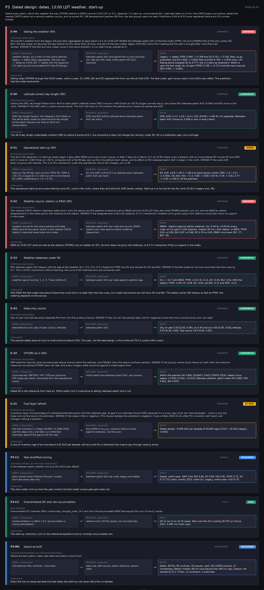

# P3: Dated design: dates, 13:00 LDT weather, start-up (2026-10-24)

What this phase ran and concluded. Generated by `scripts/make_phase_docs.py` from `src/safari_bands/phases.py`; registered hypotheses are quoted from the register, verbatim. Full results: [README.md](README.md).

Dated every patch, rebuilt the weather the way CFFDRS defines it (ERA5-Land at 13:00 LDT on D-1, Appendix C-2 start-up, overwintered DC), read leaf state on D from the CWFIS green-up product, added the nearest CWFIS station as a second weather source, and re-scored R0. 196 development patches (83 fire); the test groups were not read. Predictions E-49 to E-53 were registered before any P3 number existed.

## E-49: Dating the weather (R0) (experiment): **REFUTED**

| | |
|---|---|
| Hypothesis (registered) | Moving R0's weather from the legacy 30-June daily aggregates to each patch's D-1 at 13:00 LDT RAISES the between-patch AUC of the fast codes (FFMC, ISI) and LOWERS that of the slow codes (DC, BUI): the fast codes will describe the day before the fire rather than 30 June, and part of the slow codes' legacy 0.83 (DC) came from reading the fire year's drought after most fires had started. WRONG IF the fast and slow codes move in the same direction, or no code moves outside its CI. |
| Varied (independent) | weather design, as a chain on the same patches: legacy -> dated (daily aggregates, flat spin-up) -> dated at 13:00 LDT -> dated with the Appendix C-2 start-up and overwintered DC (the P3 design) |
| Measured (dependent) | between-patch AUC and paired fire-vs-own-confuser win rate per FWI code; within-patch HFI AUC, reported |
| Result | Legacy -> dated: FFMC 0.695 -> 0.799 and ISI 0.701 -> 0.781 (fast, up as predicted), but DC 0.828 -> 0.830 (flat) and BUI 0.765 -> 0.878 (slow, UP). Dating alone dropped DC to 0.777; the C-2 start-up restored it. Within a year the fast codes do not gain (FFMC 0.730 -> 0.717) and the slow ones do (BUI 0.691 -> 0.845). |
| Verdict | **REFUTED**: the registered prediction failed |
| Conclusion | Dating helps CFFDRS through the SLOW codes: within a year, D-1 DMC, BUI and DC separate fire from non-fire at 0.83-0.85. The fast codes' gain across years is the 2023 year effect. The prediction had the codes backwards. |

## E-50: Latitude-correct day length (R0) (experiment): **SUPPORTED**

| | |
|---|---|
| Hypothesis (registered) | Scaling the DMC day-length factors from 46 N to each patch's latitude raises DMC more at >=60 N than at <55 N (longer summer days), and raises R0's between-patch AUC of DMC and BUI more in the north. WRONG IF the DMC shift is uniform across bands. The AUC half rests on 19 northern fire patches and is read only beside the shift. |
| Varied (independent) | DMC day-length factors: Van Wagner's 46 N table vs the same table scaled by astronomical day length at the patch latitude over that at 46 N (our construction) |
| Measured (dependent) | DMC and BUI shift by latitude band; between-patch AUC per band |
| Result | DMC shift +1.4 / +3.8 / +6.4 (<55 / 55-60 / >=60 N), CIs separate. Between-patch AUC moves by 0.006 or less in every band. |
| Verdict | **SUPPORTED**: the registered prediction held |
| Conclusion | The 46 N day length understates northern DMC by about 6 points at D-1, but correcting it does not change the ranking: under R0, G5 is a calibration gap, not a skill gap. |

## E-51: Operational start-up (R0) (experiment): **MIXED**

| | |
|---|---|
| Hypothesis (registered) | The GLC-X-42 Appendix C-2 start-up (codes begin 3 days after ERA5-Land snow cover is gone, or after 3 days at or above 12 C at 13:00 where snow is absent) with an overwintered DC moves DC and DMC at D-1 more at >=60 N than at <55 N, compared with a flat 90-day spin-up from the default start values, and its effect on R0's between-patch AUC is larger in the north. WRONG IF the code shift does not grow with latitude. This is E-18's mechanism under the operational rule; E-18's imagery arm is P6. |
| Varied (independent) | start-up: flat 90-day spin-up from FFMC 85 / DMC 6 / DC 15 vs Appendix C-2 start-up with overwintered DC (cffdrs coefficients a = b = 0.75) |
| Measured (dependent) | DC and DMC shift at D-1 by latitude band; between-patch AUC per band |
| Result | DC shift -19.8 / +30.1 / +38.4 by band (grows north); DMC -1.3 / -2.0 / -1.4 (flat). DC AUC, flat -> C-2: 0.80 -> 0.80 (<55 N), 0.78 -> 0.82, 0.77 -> 0.91 (>=60 N, 19 fire patches). |
| Verdict | **MIXED**: part of the registered prediction held and part failed |
| Conclusion | The operational start-up and overwintering move DC, most in the north, where they also add skill; DMC barely notices. Start-up is a live slot for the far north (E-18's imagery arm, P6). |

## E-52: Weather source: station vs ERA5 (R0) (experiment): **REFUTED**

| | |
|---|---|
| Hypothesis (registered) | The nearest CWFIS station's reported codes at D-1 rank fire above non-fire patches at least as well as ERA5-Land at 13:00 LDT (they are what CFFDRS actually runs on), and the ERA5-to-station disagreement in the codes grows with distance to the station. WRONG IF the disagreement is flat with distance: E-17's mechanism (weather error grows away from stations) would then have no support in the codes. |
| Varied (independent) | weather source for the same patches and date: ERA5-Land at the patch centre vs the nearest CWFIS station's reported observation and codes |
| Measured (dependent) | between-patch AUC per code and source; |ERA5 - station| per code against station distance (Spearman) |
| Result | |ERA5 - station| against station distance: rho -0.03 to +0.05 for every code, all CIs span 0 (195 patches, median 56 km). AUC station vs ERA5: FFMC 0.81 vs 0.80, BUI 0.87 vs 0.88, DC 0.78 vs 0.83. ERA5 runs lower (DC -77, BUI -15). |
| Verdict | **REFUTED**: the registered prediction failed |
| Conclusion | ERA5 at 13:00 LDT ranks as well as the stations CFFDRS runs on (better for DC). Its error does not grow with distance, so E-17's mechanism finds no support in the codes. |

## E-53: Weather staleness under R0 (experiment): **SUPPORTED**

| | |
|---|---|
| Hypothesis (registered) | R0's between-patch AUC decays with the age of the weather (D-1, D-2, D-3, D-7), fastest for FFMC and ISI and slowest for DC and BUI. WRONG IF the fast codes do not lose more than the slow ones by D-7. This is E-20's mechanism without learning: the curve E-20's learned arms are compared with. |
| Varied (independent) | weather age at scoring: 1, 2, 3, 7 days before D |
| Measured (dependent) | between-patch AUC per code against weather age |
| Result | D-1 -> D-7 with ERA5: FFMC -0.10, ISI -0.11, DC -0.03, BUI -0.04. With the station: FFMC -0.09, ISI -0.08, DC -0.05, but BUI -0.11 and DMC -0.12. |
| Verdict | **SUPPORTED**: the registered prediction held |
| Conclusion | With ERA5 the fast codes lose about three times more skill in a week than the slow ones, so a week-old product can still carry DC and BUI. The station series' BUI decays as fast as FFMC: the ordering depends on the source. |

## E-43: Date-only control (experiment): **SUPPORTED**

| | |
|---|---|
| Hypothesis (registered) | Day of year and latitude alone separate fire from non-fire at about chance. WRONG IF they do not: the pseudo-date rule for negatives would then be a shortcut every arm can read. |
| Varied (independent) | date features only (day-of-year sin/cos, latitude) |
| Measured (dependent) | between-patch AUC |
| Result | Day of year 0.55 [0.50, 0.59]; sin 0.45 and cos 0.45 [0.40, 0.50]; latitude 0.53 [0.46, 0.60]. Year alone: 0.87 [0.81, 0.93]. |
| Verdict | **SUPPORTED**: the registered prediction held |
| Conclusion | The pseudo-dates leave at most a small shortcut (about 0.05). The year, not the date design, is the confound; P3-C1 scores within years. |

## E-32: CFFDRS as is (R0) (experiment): **SUPPORTED**

| | |
|---|---|
| Hypothesis (registered) | FBP head-fire intensity ranks burned pixels above chance within fire patches, and FWI/BUI ranks fire above confuser patches. WRONG IF the physics scores sit at chance on both: then the outcome measures something CFFDRS does not rate, and every imagery delta would be against a meaningless floor. |
| Varied (independent) | none learned: FBP ROS / HFI / CFB per pixel and FWI codes per patch, computed from the operational inputs |
| Measured (dependent) | within-patch and between-patch AUC, per process |
| Result | Within fire patches HFI 0.681 (SCANFI), 0.622 (CWFIS 2019): dated minus legacy +0.005 [-0.002, +0.012]. Between patches: patch-mean HFI 0.863, FWI 0.841, BUI 0.878. |
| Verdict | **SUPPORTED**: the registered prediction held |
| Conclusion | Dated R0 is the reference from here on. Within-patch skill is insensitive to dating; between-patch skill is not. |

## E-21: Fuel-layer refresh (experiment): **AT RISK**

| | |
|---|---|
| Hypothesis (registered) | A positive slope: the advantage of a refreshed estimate grows with the staleness gap. At gap 0 our estimate should LOSE, because it is a noisy copy of its own training target -- which is why the slope and not the level is the estimator. WRONG IF the slope is flat or negative. (This clause restates the prediction's negation; it was written 2026-10-24, after P2's inventory-half result, and changes nothing it predicts.) |
| Varied (independent) | the fuel inventory's vintage (SCANFI v2 2005-2020, pre-fire steps only), and later our refreshed estimate, against the gap to the fire year |
| Measured (dependent) | the SLOPE of auc_px, scenario-held-out folds against staleness, not the level |
| Result | Dated design: -0.009 AUC per decade of SCANFI age [-0.017, +0.001] (legacy: -0.005). |
| Verdict | **AT RISK**: the half that could run removes what the prediction needs |
| Conclusion | A cost of inventory age of at most about 0.02 AUC per decade: still too small for a refreshed fuel map to pay through recency alone. |

## P3-C1: Year-stratified scoring (control): **MEASURED**

| | |
|---|---|
| Question (control; no hypothesis registered) | Is the between-patch weather skill only the 2023 year effect? |
| Varied (independent) | pairs scored: every fire/non-fire pair vs pairs from the same year only |
| Measured (dependent) | between-patch AUC per code, legacy and dated |
| Result | Dated, within-year: DMC 0.84, BUI 0.85, DC 0.83, FWI 0.81, FFMC 0.72, ISI 0.72 (721 pairs, mostly 2023; wide CIs). Legacy, within-year: 0.67-0.75. |
| Verdict | **MEASURED**: no hypothesis: a measurement or control, reported as found |
| Conclusion | The slow codes' skill survives the year control; the fast codes' across-year gain does not. |

## P3-C2: Overwintered DC and rain accumulation (check): **PASS**

| | |
|---|---|
| Pass criterion | Overwintered DC matches cffdrs::overwinter_drought_code; 24 h rain from the accumulated ERA5 field equals the sum of hourly values. |
| Varied (independent) | implementation vs cffdrs 1.9.2; accumulated vs hourly precipitation |
| Measured (dependent) | relative error (35 DC cases); rain at a test day |
| Result | DC to 1e-12 on all 35 cases. Rain over the 24 h ending 19 UTC on 10 July 2021: 0.082 mm both ways. |
| Verdict | **PASS**: the check met its criterion |
| Conclusion | The start-up machinery runs on the reference equations and on correctly accumulated rain. |

## P3-M1: Inputs as built (measurement): **MEASURED**

| | |
|---|---|
| Question (measurement; no hypothesis registered) | Where did each patch's date, leaf state and station come from? |
| Varied (independent) | 229 patches (fire, confuser, unburned) |
| Measured (dependent) | date rule, leaf source, station distance, season state |
| Result | Dates: 99 fire, 95 confuser, 35 pseudo. Leaf: 191 CWFIS product, 37 climatology. Station median 56 km (one beyond the 300 km cap). Season not started by D-1: 0 fires, 11 confusers, 4 unburned. |
| Verdict | **MEASURED**: no hypothesis: a measurement or control, reported as found |
| Conclusion | Every fire has an observed date and leaf state; the start-up rule never left a fire un-started. |
