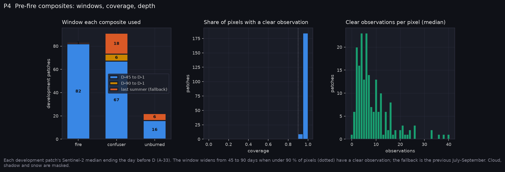
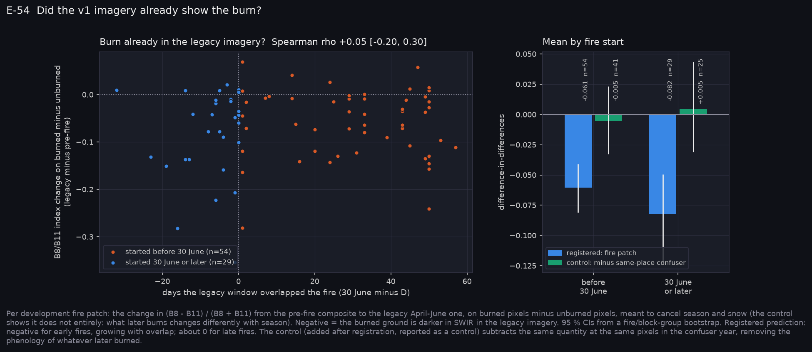
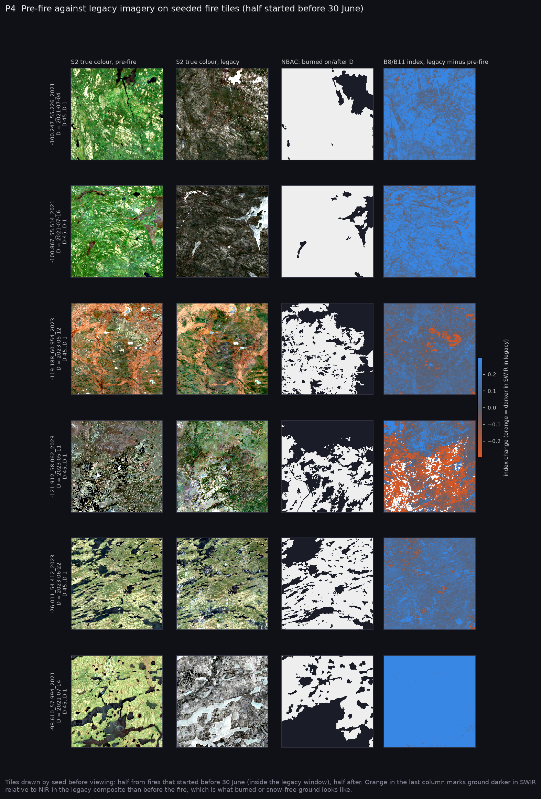

# P4: Pre-fire imagery, dated labels and the v2 pack (2026-10-25)

P4 rebuilt every patch's Sentinel-2 imagery so it ends the day before the patch's date D, relabelled NBAC by fire start, and packed the CFFDRS-mirror dataset (v2) for Narval. Decisions are in A-33. E-54 was registered in commit `c3f54f4`, before any composite was downloaded. All measurements are on the 196 development patches; the frozen test groups were not read.

**At a glance:** [experiments.md](experiments.md). Tables: [tables.md](tables.md).

## What P4 built



- **Pre-fire composites.**
  - **Window.** A median over D−45 to D−1, on each patch's own grid, so every other layer stays aligned. If the patch is under 90 % covered, the window widens to D−90 to D−1; failing that, the previous July–September is used, flagged.
  - **Masking.** Cloud, cloud shadow and snow are masked. The legacy pipeline masked only cloud.
  - **Fires** all use their own 45-day window except one.
  - **Confusers and unburned patches** fall back more often (18 and 6), mostly the early-year ones.
  - **Exclusions.** Three 2016–2017 confusers never reached 90 % coverage, because Sentinel-2 surface reflectance did not yet cover these areas well. The two below 50 % are left out of the pack.
  - **Depth.** Median 5–9 clear observations per pixel.
- **Dated labels.** A pixel is 1 if it burned in a fire that started on or after D, and ignored if the fire started before D. Because D is the earliest start of any polygon overlapping a fire patch, nothing is ignored on these patches, and every legacy burned pixel carries over. NBAC 2016–2018 were fetched, so the early confusers are labelled too.
- **The v2 pack** (`Fire_Risk_Model/data/stage2_fire_cffdrs_v2/`):
  - **Splits.** Train 162 patches (1,388 tiles), val 32 (283), test 33 (287). The test split is exactly the frozen test set's fire, confuser and unburned patches (asserted), and no group spans two splits.
  - **Imagery.** The bands are reflectance from the pre-fire composite, with a validity mask; 99.3–99.9 % of pixels are valid.
  - **Labels and fuel.** The dated label, plus CWFIS 2019 and SCANFI-tree fuel codes.
  - **Eight per-pixel slots.** Percent conifer from each source, closure, height, slope, aspect sine and cosine, and leaf state on D.
  - **A per-patch vector of 62 scalars.** Operational codes at four lags, the start-up and day-length variants, station codes and distance, FMC on D, day of year, place, and the composite window.
  - **Bundle for Narval:** `data/stage2_fire_cffdrs_v2.tar` (2.4 GB), sha256 `177717f1e5da70c36d8a3f1544a7d8c95dde832717ac9ba7fc147ac460e7d98e`.

## E-54: did the v1 imagery already show the burn? MIXED



**The prediction:** in the legacy April–June composite, burned pixels would already look burned for fires that started before 30 June. That would show as a drop in the B8/B11 index on burned relative to unburned pixels, growing with the days of overlap and absent for later fires.

**As registered:**

| Fires | Change | Share negative | n |
|---|---|---|---|
| Started before 30 June | −0.061 [−0.081, −0.041] | 83 % | 54 |
| Started on or after 30 June | −0.082 [−0.122, −0.049] | — | 29 |

- **Early fires drop.** That is what the falsification clause asked for.
- **Late fires drop too.** They should not, if the drop were the burn.
- **The drop does not grow with overlap:** ρ = +0.05 [−0.20, +0.30].

**The control** was added after registration and is labelled as such. It applies the same measure to the same pixels at the same place in the confuser's year, when nothing burned:

| Fires | Change minus confuser year | n |
|---|---|---|
| Early | −0.005 [−0.033, +0.023] | 41 |
| Late | +0.005 [−0.031, +0.044] | 25 |

The drop is the seasonal behaviour of the ground that later burns, which is mostly conifer and changes differently from aspen and open ground between April–June and the weeks before D. It is not the burn. Only the longest overlaps (41 days or more, mostly the May 2023 fires) lean negative after the control, at −0.029. One of the seeded tiles shows that plainly: the May 2023 fire at −121.9, 58.1, in the fourth row below.

**One possible reason the leak is so small** (not tested): s2cloudless flags smoke as cloud, so few clear post-fire scenes reach a median during weeks of active burning.

**What it means:**
- The v1 band searches (E-1 to E-14) were probably not reading the burn directly from the imagery.
- But their imagery was seasonally wrong: April–June medians with unmasked spring snow, against a weather design dated 30 June.
- Both reasons hold for re-running them on v2. The v1 results stay labelled "legacy".



The tiles were drawn by seed before viewing: three fires that started before 30 June and three after. Each row shows the pre-fire true colour first, then the legacy true colour, the dated label, and the index change. The legacy composites of the July fires are full of snow; the pre-fire ones are summer-green.

## What this changes

- **The imagery the models learn from now matches the moment the prediction is made.** It is cloud-, shadow- and snow-free, and it ends before the fire. Every imagery result from P5 on is read against this pack.
- **The v1 results are not invalidated by leakage**, but they are seasonally confounded. They stay "legacy".

## Next: P5

P5 builds the CFFDRS-structured network on the v2 pack: a torch mirror of the physics, the slot configurations and the R0–R4 ladder. Per the standing rule it is smoke-tested locally on a synthetic pack, and trained only on Narval.

**Transfer.** The bundle has to be moved to Narval before any P5 training (`rsync`, then `sha256sum -c`). That transfer is yours to start.

## Reproduce

Fire_Risk_Model:

```bash
python scripts/python/build_prefire.py --workers 6       # labels, composites, E-54
python scripts/python/pack_cffdrs_v2.py
python scripts/python/package_for_narval.py --h5-dir data/stage2_fire_cffdrs_v2 \
    --extra data/stage2_fire_cffdrs_v2/pack_v2_manifest.json
python scripts/python/p4_summary.py --out ../Fire_Risk_Statistics/runs/20261025-p4_prefire
# in Fire_Risk_Statistics:
python scripts/make_results_package.py --phase P4 --run runs/20261025-p4_prefire
python scripts/make_phase_docs.py --phase P4
```

## Files

- **Fire_Risk_Model:**
  - New: `src/data/prefire.py`, `src/data/pack_v2.py`.
  - Changed: `labels.py` (`rasterize_dated`, `nbac_starts`); `display_rgb.patch_true_colour`.
  - Scripts: `build_prefire.py`, `pack_cffdrs_v2.py`, `p4_summary.py`, `attach_qual_rgb.py`.
  - Tests: `test_pack_v2.py`.
- **Fire_Risk_Statistics:**
  - `make_results_package.py --phase P4`.
  - Register E-54; assumption A-33; this folder.
