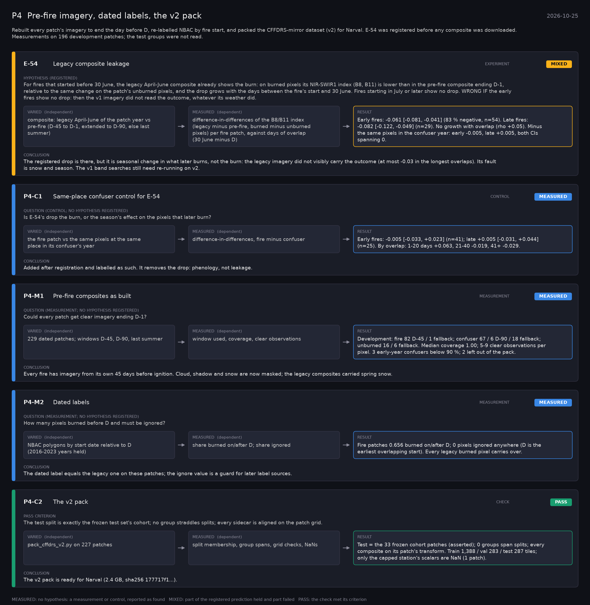

# P4: Pre-fire imagery, dated labels, the v2 pack (2026-10-25)

What this phase ran and concluded. Generated by `scripts/make_phase_docs.py` from `src/safari_bands/phases.py`; registered hypotheses are quoted from the register, verbatim. Full results: [README.md](README.md).

Rebuilt every patch's imagery to end the day before D, re-labelled NBAC by fire start, and packed the CFFDRS-mirror dataset (v2) for Narval. E-54 was registered before any composite was downloaded. Measurements on 196 development patches; the test groups were not read.

## E-54: Legacy composite leakage (experiment): **MIXED**

| | |
|---|---|
| Hypothesis (registered) | For fires that started before 30 June, the legacy April-June composite already shows the burn: on burned pixels its NIR-SWIR1 index (B8, B11) is lower than in the pre-fire composite ending D-1, relative to the same change on the patch's unburned pixels, and the drop grows with the days between the fire's start and 30 June. Fires starting in July or later show no drop. WRONG IF the early fires show no drop: then the v1 imagery did not read the outcome, whatever its weather did. |
| Varied (independent) | composite: legacy April-June of the patch year vs pre-fire (D-45 to D-1, extended to D-90, else last summer) |
| Measured (dependent) | difference-in-differences of the B8/B11 index (legacy minus pre-fire, burned minus unburned pixels) per fire patch, against days of overlap (30 June minus D) |
| Result | Early fires: -0.061 [-0.081, -0.041] (83 % negative, n=54). Late fires: -0.082 [-0.122, -0.049] (n=29). No growth with overlap (rho +0.05). Minus the same pixels in the confuser year: early -0.005, late +0.005, both CIs spanning 0. |
| Verdict | **MIXED**: part of the registered prediction held and part failed |
| Conclusion | The registered drop is there, but it is seasonal change in what later burns, not the burn: the legacy imagery did not visibly carry the outcome (at most -0.03 in the longest overlaps). Its fault is snow and season. The v1 band searches still need re-running on v2. |

## P4-C1: Same-place confuser control for E-54 (control): **MEASURED**

| | |
|---|---|
| Question (control; no hypothesis registered) | Is E-54's drop the burn, or the season's effect on the pixels that later burn? |
| Varied (independent) | the fire patch vs the same pixels at the same place in its confuser's year |
| Measured (dependent) | difference-in-differences, fire minus confuser |
| Result | Early fires: -0.005 [-0.033, +0.023] (n=41); late +0.005 [-0.031, +0.044] (n=25). By overlap: 1-20 days +0.063, 21-40 -0.019, 41+ -0.029. |
| Verdict | **MEASURED**: no hypothesis: a measurement or control, reported as found |
| Conclusion | Added after registration and labelled as such. It removes the drop: phenology, not leakage. |

## P4-M1: Pre-fire composites as built (measurement): **MEASURED**

| | |
|---|---|
| Question (measurement; no hypothesis registered) | Could every patch get clear imagery ending D-1? |
| Varied (independent) | 229 dated patches; windows D-45, D-90, last summer |
| Measured (dependent) | window used, coverage, clear observations |
| Result | Development: fire 82 D-45 / 1 fallback; confuser 67 / 6 D-90 / 18 fallback; unburned 16 / 6 fallback. Median coverage 1.00; 5-9 clear observations per pixel. 3 early-year confusers below 90 %; 2 left out of the pack. |
| Verdict | **MEASURED**: no hypothesis: a measurement or control, reported as found |
| Conclusion | Every fire has imagery from its own 45 days before ignition. Cloud, shadow and snow are now masked; the legacy composites carried spring snow. |

## P4-M2: Dated labels (measurement): **MEASURED**

| | |
|---|---|
| Question (measurement; no hypothesis registered) | How many pixels burned before D and must be ignored? |
| Varied (independent) | NBAC polygons by start date relative to D (2016-2023 years held) |
| Measured (dependent) | share burned on/after D; share ignored |
| Result | Fire patches 0.656 burned on/after D; 0 pixels ignored anywhere (D is the earliest overlapping start). Every legacy burned pixel carries over. |
| Verdict | **MEASURED**: no hypothesis: a measurement or control, reported as found |
| Conclusion | The dated label equals the legacy one on these patches; the ignore value is a guard for later label sources. |

## P4-C2: The v2 pack (check): **PASS**

| | |
|---|---|
| Pass criterion | The test split is exactly the frozen test set's cohort; no group straddles splits; every sidecar is aligned on the patch grid. |
| Varied (independent) | pack_cffdrs_v2.py on 227 patches |
| Measured (dependent) | split membership, group spans, grid checks, NaNs |
| Result | Test = the 33 frozen cohort patches (asserted); 0 groups span splits; every composite on its patch's transform. Train 1,388 / val 283 / test 287 tiles; only the capped station's scalars are NaN (1 patch). |
| Verdict | **PASS**: the check met its criterion |
| Conclusion | The v2 pack is ready for Narval (2.4 GB, sha256 177717f1...). |
