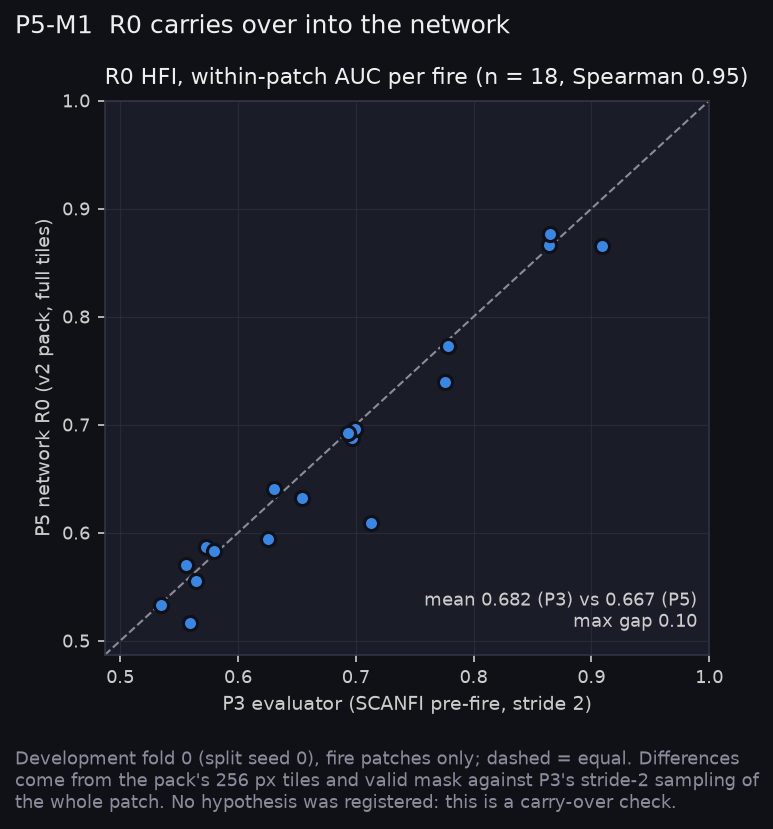
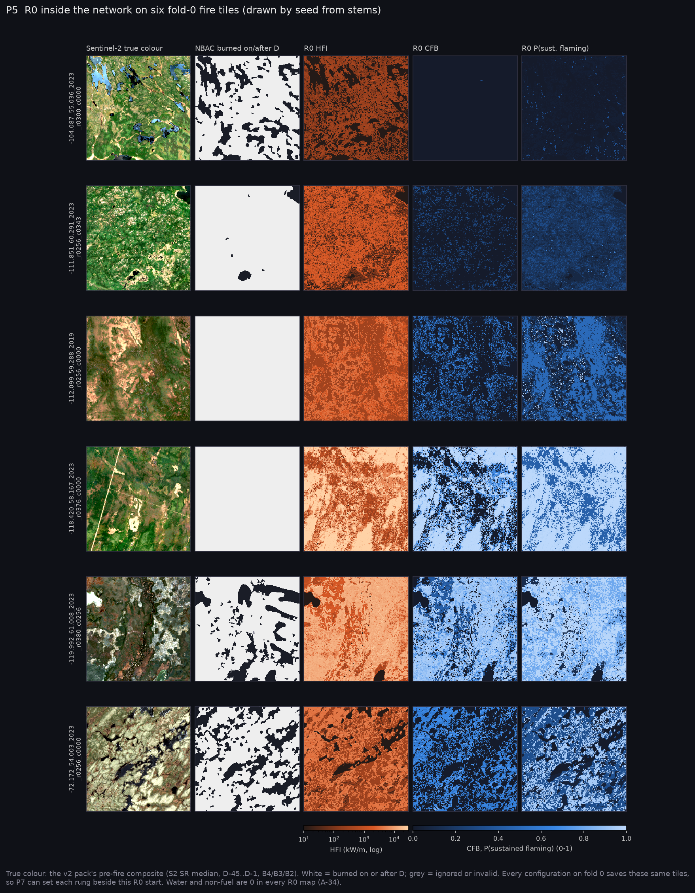

# P5: The CFFDRS-structured network (2026-10-25)

P5 built the learned rungs of the reference ladder (R0 to R4) in Fire_Risk_FW and the Narval sweep that trains them. Nothing was trained beyond smoke tests: the registered experiments that use these rungs (E-34, E-36, E-37, E-38; partly E-16, E-20, E-35, E-40) are queued and are scored in P7. Design decisions are in A-34. The real-data checks use fold 0 of the development set; the test split was not staged.

**At a glance:** [experiments.md](experiments.md). Tables: [tables.md](tables.md).

## What P5 built (Fire_Risk_FW)

| Piece | File | What it does |
|---|---|---|
| FBP in torch | `src/fire_risk_fw/fbp_torch.py` | ROS, CFB, SFC, TFC, HFI, ISI, WSV, CSI, RSO for every fuel, gradient-safe |
| Ignition in torch | `src/fire_risk_fw/ignition_torch.py` | Beverly & Wotton (2007) P(sustained flaming); 2019 fuel-code table |
| Slot configurations | `src/fire_risk_fw/slots.py`, `configs/cffdrs/runs/*.json` | One JSON per run: rung, fuel source, weather source/variant/lag, slot sources, shuffled twin. Invalid combinations are refused; `imagery_replace` stops with a P6 message |
| The network | `src/fire_risk_fw/cffdrs_net.py` | `SlotNet`: R0 physics, R1 inputs only, R2 physics + residual, R3 bounded imagery corrections through the physics, R4 free imagery branch |
| v2 data | `src/fire_risk_fw/data_v2.py` | Pack reader (no flips: aspect and wind are bearings), fire-aware group folds over train + val |
| One fit | `scripts/run_slots.py` | Writes `result.json`, `patches.csv`, `hist.npz`, `samples.npz`, and a line in `fits.jsonl` |
| The sweep | `scripts/shell/sweep_slots.sh` | Slurm array: configuration × 5 folds × 3 seeds |

**How the ladder starts.** R2's logit starts as log1p(HFI) − 7. Its residual, every imagery correction and R4's imagery branch start at exactly zero, so each rung begins where the one below ends and anything it adds is learned (P5-C2).

**The 20 configurations queued** (300 fits at 5 folds × 3 seeds):

| Rung | Configurations | Register |
|---|---|---|
| R0 | `r0_scanfi`, `r0_cwfis` | E-34 (reference) |
| R1, R2 | `r1`, `r2`, `r2_cwfis` | E-34; E-35's cffdrs half |
| R2 variants | `r2_station`, `r2_lag7`, `r2_leaf_ablated` | E-52 under learning; E-20; E-40 |
| R3 | `r3_pc`, `r3_fmc`, `r3_cbh`, `r3_curing`, `r3_pc_fmc_cbh` | E-36, E-16, E-37, E-38 |
| R4 | `r4` | total imagery value |
| Twins | `*_shuffled` for each R3 and R4 | each must be about 0 |

## Checks

- **P5-C1, physics parity: PASS.** The torch FBP matches the NumPy port to 1e-9 on all ten outputs over the 6,000-row cffdrs fixture. Ignition matches for every fuel, green or leafless. Gradients are finite.
- **P5-C2, ladder contracts: PASS.** All 14 contract tests hold.
- **P5-C3, one fit end to end: PASS.** Five configurations on a synthetic pack write every artefact, and every configuration on a fold maps the same sample tiles.
- **P5-C4, fixed on the way:**
  - The scorer's tie handling was quadratic and timed out on real tiles. It is now vectorised and exact against brute force.
  - A preflight test re-imported h5py and broke 23 later tests. It now restores the modules it hides.
  - Sample tiles were whatever the first validation batch held (one confuser patch). They are now a seeded draw of fire tiles, by stem, identical across configurations, with true colour saved beside them.
  - Full Fire_Risk_FW suite: 381 passed, 2 skipped.

## R0 carries over into the network (P5-M1)



On the 18 fold-0 fires, the network's R0 ranks fires as the P3 evaluator did: Spearman 0.95, mean within-patch HFI AUC 0.667 against 0.682, largest gap 0.10. The remaining differences come from sampling: the pack's 256 px tiles and valid mask, against P3's stride-2 pass over the whole patch.

**P(sustained flaming) reads higher in the network** (0.672 against 0.573) by convention, not physics. The network gives water and non-fuel P = 0, where P3 left them out. Compare P(sf) from P5 on only with itself.



The six tiles above are the ones every fold-0 configuration saves, so P7 can set each rung's map beside this R0 start.

## R3 on real data (P5-M2)

Three CPU batches of `r3_pc_fmc_cbh`: pooled AUC 0.722 against R0's 0.723. The HFI weight is 0.994, every other physics weight is within 0.006 of 0, and the run took 63 s. The fit runs on the real pack and starts at R0; nothing is learned yet, as intended. This is a smoke test, not a result.

## Launching on Narval

Pull both repositories, check the pack's sha256, then:

```bash
cd ~/Fire_Risk_FW
bash scripts/shell/sweep_slots.sh                                 # dry run: prints the 300 tasks
SUBMIT=1 CONFIGS="r2" SEEDS=1 bash scripts/shell/sweep_slots.sh   # 5 fits, to calibrate time
# after reading runs/.../fits.jsonl (wall_s) and adjusting --time:
SUBMIT=1 bash scripts/shell/sweep_slots.sh                        # the full array
```

The `--time=3:00:00` per fit is a first guess. R0 fits are evaluation only (about 20 s each) and identical across seeds, so they can be run once per fold.

## Caveats

- **Curing** uses the FBP default of 80 %, because the CWFIS curing product is not held. E-38 measures a correction to a default, not to the operational product.
- **Lagged and station configurations** pair their codes with lag-1 ERA5 wind, RH and FMC (A-34).
- **Nothing here is a finding about imagery.** P5 delivers the instrument; P7 reads it.
