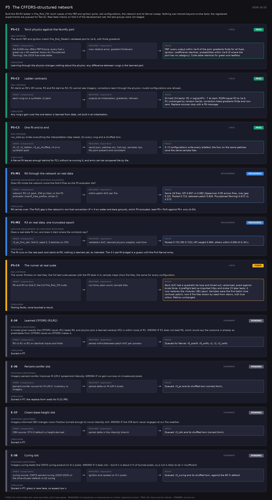

# P5: The CFFDRS-structured network (2026-10-25)

What this phase ran and concluded. Generated by `scripts/make_phase_docs.py` from `src/safari_bands/phases.py`; registered hypotheses are quoted from the register, verbatim. Full results: [README.md](README.md).

Built the R0-R4 ladder in Fire_Risk_FW: torch copies of the FBP and ignition ports, slot configurations, the network and its Narval sweep. Nothing was trained beyond smoke tests; the registered experiments are queued for Narval. Real-data checks on fold 0 of the development set; the test groups were not staged.

## P5-C1: Torch physics against the NumPy port (check): **PASS**

| | |
|---|---|
| Pass criterion | The torch FBP and ignition match Fire_Risk_Model's validated port to 1e-9, with finite gradients. |
| Varied (independent) | the 6,000-row cffdrs FBP fixture; every fuel x green-up x 40 weather draws for P(sustained flaming); the 2019 fuel-code table |
| Measured (dependent) | max relative error; gradient finiteness |
| Result | FBP: every output within 1e-9 of the port, gradients finite for all fuels. Ignition: coefficients identical, probabilities within 1e-9 (0 where the port has no category). Code table identical for green and leafless. |
| Verdict | **PASS**: the check met its criterion |
| Conclusion | Learning through the physics changes nothing about the physics: any difference between rungs is the learned part. |

## P5-C2: Ladder contracts (check): **PASS**

| | |
|---|---|
| Pass criterion | R2 starts as R0's HFI score; R3 and R4 start as R2; R1 cannot see imagery; corrections learn through the physics; invalid configurations are refused. |
| Varied (independent) | each rung on a synthetic v2 pack |
| Measured (dependent) | outputs at initialisation; gradients; refusals |
| Result | All hold (14 tests): R2 = log1p(HFI) - 7 at start, R3/R4 equal R2 to 1e-5, R1 unchanged by random bands, correction-head gradients finite and non-zero. Replace sources stop with a P6 message. |
| Verdict | **PASS**: the check met its criterion |
| Conclusion | Any rung's gain over the one below is learned from data, not built in at initialisation. |

## P5-C3: One fit end to end (check): **PASS**

| | |
|---|---|
| Pass criterion | run_slots.py writes everything the interpretation step needs, for every rung and a shuffled twin. |
| Varied (independent) | r0, r2, r2_station, r3_pc_shuffled, r4 on a synthetic pack |
| Measured (dependent) | result.json, patches.csv, hist.npz, samples.npz, fits.jsonl present and consistent |
| Result | 5 / 5 configurations write every artefact; the four on the same patches save the same sample tiles. |
| Verdict | **PASS**: the check met its criterion |
| Conclusion | A Narval fit leaves enough behind for P11 without re-running it, and arms can be compared tile by tile. |

## P5-M1: R0 through the network on real data (measurement): **MEASURED**

| | |
|---|---|
| Question (measurement; no hypothesis registered) | Does R0 inside the network score the fold-0 fires as the P3 evaluator did? |
| Varied (independent) | network R0 (v2 pack, 256 px tiles) vs the P3 evaluator (scanfi_tree_prefire, stride 2) |
| Measured (dependent) | within-patch AUC per fire |
| Result | Same 18 fires: HFI 0.667 vs 0.682 (Spearman 0.95 across fires, max gap 0.10). Pooled 0.723, between-patch 0.826. P(sustained flaming) 0.672 vs 0.573. |
| Verdict | **MEASURED**: no hypothesis: a measurement or control, reported as found |
| Conclusion | R0 carries over. The P(sf) gap is the network's non-fuel convention (P = 0 on water and bare ground), which P3 excluded; read P5+ P(sf) against P5+ only (A-34). |

## P5-M2: R3 on real data, one truncated epoch (measurement): **MEASURED**

| | |
|---|---|
| Question (measurement; no hypothesis registered) | Does a real-data fit run, and does it start where the contracts say? |
| Varied (independent) | r3_pc_fmc_cbh, fold 0, seed 0, 3 batches on CPU |
| Measured (dependent) | validation AUC; learned physics weights; wall time |
| Result | Pooled 0.722 (R0 0.723); HFI weight 0.994, others within 0.006 of 0; 63 s. |
| Verdict | **MEASURED**: no hypothesis: a measurement or control, reported as found |
| Conclusion | The fit runs on the real pack and starts at R0; nothing is learned yet, as intended. The 3 h per-fit budget is a guess until the first Narval array. |

## P5-C4: The runner at real scale (check): **FIXED**

| | |
|---|---|
| Pass criterion | The scorer finishes on real tiles; the full test suite passes with the P5 tests in it; sample maps show fire tiles, the same for every configuration. |
| Varied (independent) | R0 and R3 on fold 0; the full Fire_Risk_FW suite |
| Measured (dependent) | run time; pass count; sample tiles |
| Result | Rank AUC had a quadratic tie loop and timed out; vectorised, exact against brute force. A preflight test re-imported h5py and broke 23 later tests; it now restores the modules (381 pass). Samples were the first batch (one confuser patch); now 6 fire tiles drawn by seed from stems, with true colour. Metrics unchanged. |
| Verdict | **FIXED**: the check failed, the cause was fixed, and it now passes |
| Conclusion | Tooling faults; none touched a result. |

## E-34: Learned CFFDRS (R1/R2) (experiment): **PENDING**

| | |
|---|---|
| Hypothesis (registered) | A model given exactly the CFFDRS inputs (R1) beats R0, and physics plus a learned residual (R2) is within noise of R1. WRONG IF R1 does not beat R0, which would say the outcome is already as predictable from CFFDRS inputs as CFFDRS makes it. |
| Varied (independent) | R0 vs R1 vs R2 on identical inputs and folds |
| Measured (dependent) | paired within/between-patch AUC per process |
| Result | Queued for Narval: r0_scanfi, r0_cwfis, r1, r2, r2_cwfis. |
| Verdict | **PENDING**: not yet run |
| Conclusion | Scored in P7. |

## E-36: Percent-conifer slot (experiment): **PENDING**

| | |
|---|---|
| Hypothesis (registered) | Imagery percent conifer improves M-1/M-2 spread and intensity. WRONG IF no gain survives on mixedwood pixels. |
| Varied (independent) | percent-conifer source for M-1/M-2: inventory vs imagery |
| Measured (dependent) | paired delta on M-1/M-2 pixels |
| Result | Queued: r3_pc and its shuffled twin (correct form). |
| Verdict | **PENDING**: not yet run |
| Conclusion | Scored in P7; the replace form waits for E-22 (P6). |

## E-37: Crown-base-height slot (experiment): **PENDING**

| | |
|---|---|
| Hypothesis (registered) | Imagery-informed CBH changes crown fraction burned enough to move intensity skill. WRONG IF the CFB term never engages at our fire weather. |
| Varied (independent) | CBH source: ST-X-3 default vs height-derived |
| Measured (dependent) | paired delta in the intensity branch |
| Result | Queued: r3_cbh and its shuffled twin (correct form). |
| Verdict | **PENDING**: not yet run |
| Conclusion | Scored in P7. |

## E-38: Curing slot (experiment): **PENDING**

| | |
|---|---|
| Hypothesis (registered) | Imagery curing beats the CWFIS curing product on O-1 pixels. WRONG IF it does not -- but O-1 is about 3 % of burned pixels, so a null is likely to be 'n insufficient'. |
| Varied (independent) | curing source: CWFIS percent curing (2020-2025) or the time-of-year default vs S2 curing |
| Measured (dependent) | ignition and spread on O-1 pixels |
| Result | Queued: r3_curing and its shuffled twin, against the 80 % default. |
| Verdict | **PENDING**: not yet run |
| Conclusion | Scored in P7; grass is rare here, so expect low n. |
