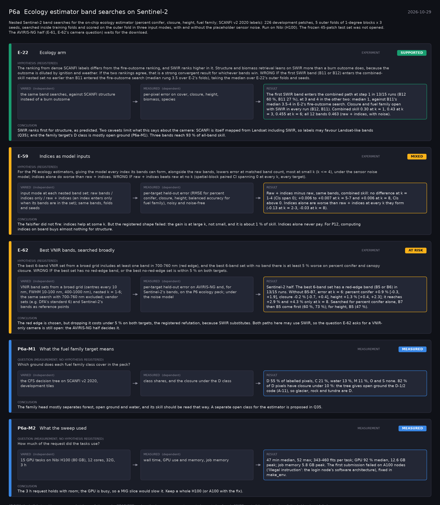

# P6a: Ecology estimator band searches on Sentinel-2 (2026-10-29)

What this phase ran and concluded. Generated by `scripts/make_phase_docs.py` from `src/safari_bands/phases.py`; registered hypotheses are quoted from the register, verbatim. Full results: [README.md](README.md).

Nested Sentinel-2 band searches for the on-chip ecology estimator (percent conifer, closure, height, fuel family; SCANFI v2 2020 labels): 226 development patches, 5 outer folds of 1-degree blocks x 3 seeds, searched inside training folds and scored on the outer fold in three input modes, with and without the placeholder sensor noise. Run on Nibi (H100). The frozen 45-patch test set was not opened. The AVIRIS-NG half (E-61, E-62's camera question) waits for the download.

## E-22: Ecology arm (experiment): **SUPPORTED**

| | |
|---|---|
| Hypothesis (registered) | The ranking from dense SCANFI labels differs from the fire-outcome ranking, and SWIR ranks higher in it. Structure and biomass retrieval leans on SWIR more than a burn outcome does, because the outcome is diluted by ignition and weather. If the two rankings agree, that is a strong convergent result for whichever bands win. WRONG IF the first SWIR band (B11 or B12) enters the combined-skill nested set no earlier than B11 entered the fire-outcome search (median rung 3.5 over E-2's folds), taking the median over E-22's outer folds and seeds. |
| Varied (independent) | the same band searches, against SCANFI structure instead of a burn outcome |
| Measured (dependent) | per-pixel error on cover, closure, height, biomass, species |
| Result | The first SWIR band enters the combined path at step 1 in 13/15 runs (B12 60 %, B11 27 %), at 3 and 4 in the other two: median 1, against B11's median 3.5-4 in E-2's fire-outcome search. Closure and fuel family open with SWIR in every run (B12, B11). Combined skill 0.30 at k = 1, 0.43 at k = 3, 0.455 at k = 6; all 12 bands 0.463 (raw + indices, with noise). |
| Verdict | **SUPPORTED**: the registered prediction held |
| Conclusion | SWIR ranks first for structure, as predicted. Two caveats limit what this says about the camera: SCANFI is itself mapped from Landsat including SWIR, so labels may favour Landsat-like bands (Q35); and the family target's D class is mostly open ground (P6a-M1). Three bands reach 93 % of all-band skill. |

## E-59: Indices as model inputs (experiment): **MIXED**

| | |
|---|---|
| Hypothesis (registered) | For the P6 ecology estimators, giving the model every index its bands can form, alongside the raw bands, lowers error at matched band count, most at small k (k <= 4), under the sensor noise model; indices alone do worse than raw + indices. WRONG IF raw + indices beats raw at no k (spatial-block paired CI spanning 0 at every k, every target). |
| Varied (independent) | input mode at each nested band set: raw bands / indices only / raw + indices (an index enters only when its bands are in the set); same bands, folds and seeds |
| Measured (dependent) | per-target held-out error (RMSE for percent conifer, closure, height; balanced accuracy for fuel family), noisy and noise-free |
| Result | Raw + indices minus raw, same bands, combined skill: no difference at k = 1-4 (CIs span 0); +0.006 to +0.007 at k = 5-7 and +0.006 at k = 8, CIs above 0. Indices alone are worse than raw + indices at every k they form (-0.13 at k = 2-3, -0.03 at k = 8). |
| Verdict | **MIXED**: part of the registered prediction held and part failed |
| Conclusion | The falsifier did not fire: indices help at some k. But the registered shape failed: the gain is at large k, not small, and it is about 1 % of skill. Indices alone never pay. For P12, computing indices on board buys almost nothing for structure. |

## E-62: Best VNIR bands, searched broadly (experiment): **AT RISK**

| | |
|---|---|
| Hypothesis (registered) | The best 6-band VNIR set from a broad grid includes at least one band in 700-760 nm (red edge), and the best 6-band set with no band there is at least 5 % worse on percent conifer and canopy closure. WRONG IF the best set has no red-edge band, or the best no-red-edge set is within 5 % on both targets. |
| Varied (independent) | VNIR band sets from a broad grid (centres every 10 nm, FWHM 10-100 nm, 400-1000 nm), nested k = 1-6; the same search with 700-760 nm excluded; vendor sets (e.g. DFA's standard 6) and Sentinel-2's bands as reference points |
| Measured (dependent) | per-target held-out error on AVIRIS-NG and, for Sentinel-2's bands, on the P6 ecology pack; under the noise model |
| Result | Sentinel-2 half. The best 6-band set has a red-edge band (B5 or B6) in 13/15 runs. Without B5-B7, error at k = 6: percent conifer +0.9 % [-0.3, +1.9], closure -0.2 % [-0.7, +0.4], height +1.3 % [+0.4, +2.3]; it reaches +2.9 % and +4.3 % only at k = 8. Searched for percent conifer alone, B7 then B5 come first (60 %, 73 %); for height, B5 (47 %). |
| Verdict | **AT RISK**: the half that could run removes what the prediction needs |
| Conclusion | The red edge is chosen, but dropping it costs under 5 % on both targets, the registered refutation, because SWIR substitutes. Both paths here may use SWIR, so the question E-62 asks for a VNIR-only camera is still open: the AVIRIS-NG half decides it. |

## P6a-M1: What the fuel family target means (measurement): **MEASURED**

| | |
|---|---|
| Question (measurement; no hypothesis registered) | Which ground does each fuel family class cover in the pack? |
| Varied (independent) | the CFS decision tree on SCANFI v2 2020, development tiles |
| Measured (dependent) | class shares, and the closure under the D class |
| Result | D 55 % of labelled pixels, C 21 %, water 13 %, M 11 %, O and S none. 82 % of D pixels have closure under 10 %: the tree gives open ground the D-1/2 code (A-11), so glacier, rock and tundra are D. |
| Verdict | **MEASURED**: no hypothesis: a measurement or control, reported as found |
| Conclusion | The family head mostly separates forest, open ground and water, and its skill should be read that way. A separate open class for the estimator is proposed in Q35. |

## P6a-M2: What the sweep used (measurement): **MEASURED**

| | |
|---|---|
| Question (measurement; no hypothesis registered) | How much of the request did the tasks use? |
| Varied (independent) | 15 GPU tasks on Nibi H100 (80 GB), 12 cores, 32G, 3 h |
| Measured (dependent) | wall time, GPU use and memory, job memory |
| Result | 47 min median, 52 max; 343-460 fits per task; GPU 92 % median, 12.6 GB peak; job memory 5.8 GB peak. The first submission failed on A100 nodes ('Illegal instruction': the login node's software architecture), fixed in make_env. |
| Verdict | **MEASURED**: no hypothesis: a measurement or control, reported as found |
| Conclusion | The 3 h request holds with room; the GPU is busy, so a MIG slice would slow it. Keep a whole H100 (or A100 with the fix). |
