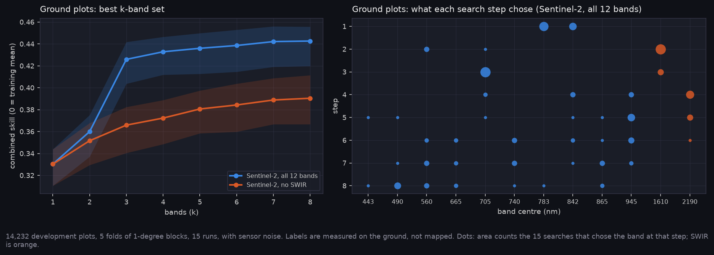
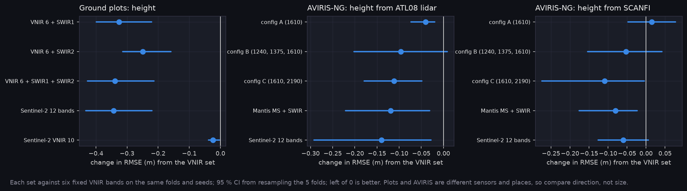

# P6a-ext v2: Band rankings on labels that owe nothing to Landsat, full lidar (Q35)

This repeats `../p6a_external_labels/` with the full lidar pack. SCANFI is mapped from Landsat, SWIR included, so SWIR ranking first against it could be the labels favouring their own bands (E-22, Q35). Two independent label sources test that with the same search: ground plots (MAGPlot, measured percent conifer and height, Sentinel-2 bands) and ATL08 lidar height (AVIRIS-NG bands). No hypothesis was registered for this test, so it is reported as a measurement.

Runs on Nibi:
- `hs_plots/20261101-2024`: 14,232 plots in 171 blocks. Unchanged from v1, so the plot numbers are the same.
- `hs_lidar_v2/20261102-1959`: 139,848 pixels in 14 groups, from 35 of the 37 development lines (`aviris_lidar_v2`, A-44). This replaces v1's 98,586 pixels in 11 groups.
- The SCANFI comparison now comes from `hs_v4`.

All 15 tasks per arm finished. Frozen plots and AVIRIS test data were not transferred. Both runs use the placeholder noise model (A-37).

**At a glance:** [experiments.md](experiments.md). Tables and options: [tables.md](tables.md).

Generated with:

```bash
python scripts/make_results_package.py --phase P6x --run narval_results/hs_plots/20261101-2024 \
    --lidar-run narval_results/hs_lidar_v2/20261102-1959 --scanfi-run narval_results/hs_v4/20261102-1959 \
    --out docs/results/p6a_external_labels_v2
python scripts/make_experiment_qual.py --only E-22 --lidar-run narval_results/hs_lidar_v2/20261102-1959 \
    --lidar-pack ../Fire_Risk_Model/data/aviris_lidar_v2/dev.npz --ext-out docs/results/p6a_external_labels_v2
python scripts/make_phase_docs.py --phase P6a-ext-v2
```

## Ground plots: unchanged



Same run as v1. SWIR1 lowers percent-conifer RMSE by 1.51 % [1.25, 1.70] and height RMSE by 0.33 m [0.22, 0.40], in 5 of 5 folds. SWIR2 adds +0.005 skill on top of SWIR1. NIR is picked first in all 15 searches, and 1610 nm second in 11.

## Lidar: SWIR now helps height in every fixed set, and the searches can be read



| Added to six VNIR bands (ATL08 height) | Height RMSE change, from 3.85 m [95 % CI] | Folds better |
|---|---|---|
| Config A (1610) | −0.040 [−0.074, −0.020] | 5/5 |
| Config B (1240, 1375, 1610) | −0.096 [−0.202, +0.009] | 4/5 |
| Config C (1610, 2190) | −0.112 [−0.178, −0.049] | 5/5 |
| Mantis MS + SWIR | −0.119 [−0.221, −0.031] | 4/5 |
| Sentinel-2 12 bands | −0.139 [−0.292, −0.028] | 4/5 |
| Searched standard InGaAs, k = 4 | −0.131 [−0.235, −0.040] | 4/5 |
| Searched extended InGaAs, k = 4 | −0.082 [−0.163, +0.017] | 4/5 |

- **Every SWIR set lowers height error.** Config C now has a CI clear of 0; in v1 it reached 0.
- **The searches can now be read.** In v1 one fold had only 2,435 inner-validation pixels. The smallest is now 20,490, and searched standard InGaAs beats fixed VNIR.
- **Standard InGaAs is enough for lidar height.** Searched extended minus searched standard is +0.05 m [−0.00, +0.11]: extended is no better, and probably worse. The searched standard set ties config C (−0.02 m [−0.06, +0.02]). Config B ties config C too (+0.02 m [−0.05, +0.09]).
- **2190 nm added to 1610 nm does help:** config C against config A is −0.07 m [−0.14, −0.02]. A 1240 nm band, or a searched set of standard bands, gets the same result without the extended detector.
- **The folds still differ widely.** Fixed-VNIR skill runs from 0.01 to 0.28 across folds, so the CIs are wide.

## Against SCANFI on the same sensor (hs_v4)

| Height RMSE change from six VNIR | SCANFI labels | ATL08 lidar |
|---|---|---|
| Config A | +0.015 [−0.048, +0.077] | −0.040 [−0.074, −0.020] |
| Config B | −0.053 [−0.154, +0.042] | −0.096 [−0.202, +0.009] |
| Config C | −0.109 [−0.274, −0.004] | −0.112 [−0.178, −0.049] |
| Searched extended minus searched standard | −0.087 [−0.232, −0.007] | +0.048 [−0.003, +0.108] |

- **For fixed sets, SCANFI doesn't inflate SWIR's value for height.** If anything, lidar shows the larger gains.
- **The one disagreement is the searched sets.** On SCANFI, extended beats standard on height (the E-61 refutation in `../p6a_hs_v4/`). On lidar it doesn't. SCANFI is mapped from Landsat, including its 2.2 µm band. That fits a mild bias toward SWIR2 placements in the SCANFI labels, but it isn't proof: the two runs also differ in pixels and folds.

## What this says about P12

- **The SWIR ranking holds against labels that owe nothing to Landsat:** plots for percent conifer and height, lidar for height.
- **For height, the SWIR2 case is weak.** Lidar ranks a standard-InGaAs set as high as config C. The SWIR2 evidence that survives is from ground plots (+0.005 skill over SWIR1 alone) and config C over config A.
- **The percent-conifer puzzle remains.** Ground plots show an 8 % gain from SWIR, while AVIRIS-NG on SCANFI shows none. Lidar doesn't measure percent conifer, so it can't settle this.

## Limits

- **Plots are mostly eastern.** Most are in Québec and New Brunswick, with Newfoundland and Yukon. Western boreal forest is barely covered.
- **Plots only cover forest.** The families are C, D and M, with no open ground, water or slash. Closure isn't measured.
- **Time gap.** Plots from 2014 onward meet a 2019–2021 composite (A-44).
- **Lidar covers tracks, not swaths.** Two of 37 development lines have no ATL08.
- **The label field in the result files is still wrong.** It reads SCANFI in all three runs, because these runs predate the runner fix. Pixel counts (139,848 for lidar) confirm the right packs ran.

## Options and cost

`tables.md` lists every option with cost, pros and cons (A-41). Cost is qualitative, since Q6 is open: VNIR low, standard InGaAs moderate, extended InGaAs high.

## Files

| File | What it shows |
|---|---|
| `experiments.png`, `experiments.md` | phase sheet |
| `plots_search.png` | nested skill and what each step chose on ground plots |
| `swir_gain.png` | change in height RMSE from SWIR on the three label sources |
| `qual_E-22_plots_map.png` | where SWIR1 lowers error against plots |
| `qual_lidar_tracks.png` | lidar height along held-out flight lines |
| `tables.md`, `T_options_*.csv`, `summary.json` | the numbers |

<!-- qual:start -->
## Qualitative view per experiment

- **E-22** Ecology arm (cell map and lidar tracks): [qual_E-22_plots_map.png](qual_E-22_plots_map.png), [qual_lidar_tracks.png](qual_lidar_tracks.png)
<!-- qual:end -->
