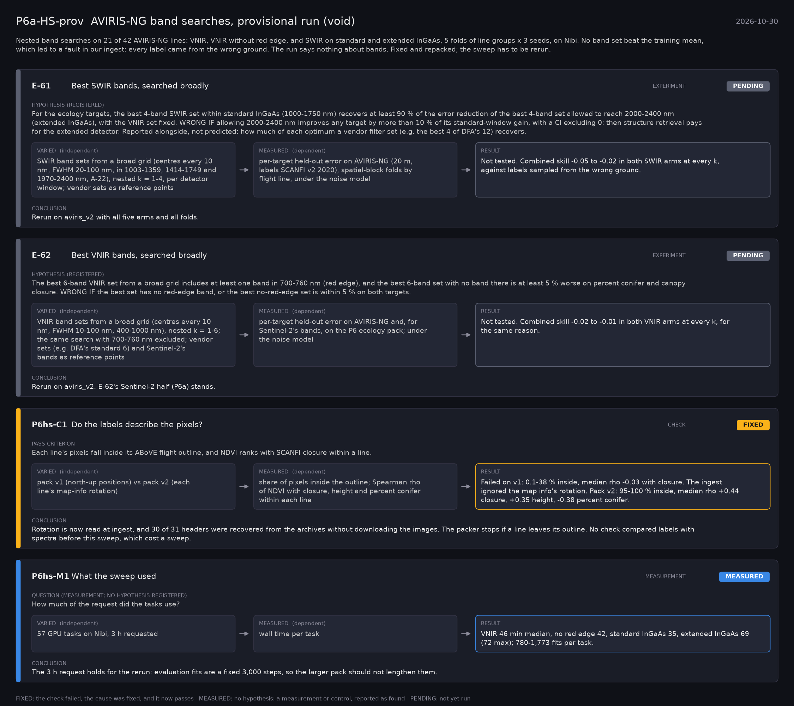

# P6a-HS-prov: AVIRIS-NG band searches, provisional run (void) (2026-10-30)

What this phase ran and concluded. Generated by `scripts/make_phase_docs.py` from `src/safari_bands/phases.py`; registered hypotheses are quoted from the register, verbatim. Full results: [README.md](README.md).

Nested band searches on 21 of 42 AVIRIS-NG lines: VNIR, VNIR without red edge, and SWIR on standard and extended InGaAs, 5 folds of line groups x 3 seeds, on Nibi. No band set beat the training mean, which led to a fault in our ingest: every label came from the wrong ground. The run says nothing about bands. Fixed and repacked; the sweep has to be rerun.

## E-61: Best SWIR bands, searched broadly (experiment): **PENDING**

| | |
|---|---|
| Hypothesis (registered) | For the ecology targets, the best 4-band SWIR set within standard InGaAs (1000-1750 nm) recovers at least 90 % of the error reduction of the best 4-band set allowed to reach 2000-2400 nm (extended InGaAs), with the VNIR set fixed. WRONG IF allowing 2000-2400 nm improves any target by more than 10 % of its standard-window gain, with a CI excluding 0: then structure retrieval pays for the extended detector. Reported alongside, not predicted: how much of each optimum a vendor filter set (e.g. the best 4 of DFA's 12) recovers. |
| Varied (independent) | SWIR band sets from a broad grid (centres every 10 nm, FWHM 20-100 nm, in 1003-1359, 1414-1749 and 1970-2400 nm, A-22), nested k = 1-4, per detector window; vendor sets as reference points |
| Measured (dependent) | per-target held-out error on AVIRIS-NG (20 m, labels SCANFI v2 2020), spatial-block folds by flight line, under the noise model |
| Result | Not tested. Combined skill -0.05 to -0.02 in both SWIR arms at every k, against labels sampled from the wrong ground. |
| Verdict | **PENDING**: not yet run |
| Conclusion | Rerun on aviris_v2 with all five arms and all folds. |

## E-62: Best VNIR bands, searched broadly (experiment): **PENDING**

| | |
|---|---|
| Hypothesis (registered) | The best 6-band VNIR set from a broad grid includes at least one band in 700-760 nm (red edge), and the best 6-band set with no band there is at least 5 % worse on percent conifer and canopy closure. WRONG IF the best set has no red-edge band, or the best no-red-edge set is within 5 % on both targets. |
| Varied (independent) | VNIR band sets from a broad grid (centres every 10 nm, FWHM 10-100 nm, 400-1000 nm), nested k = 1-6; the same search with 700-760 nm excluded; vendor sets (e.g. DFA's standard 6) and Sentinel-2's bands as reference points |
| Measured (dependent) | per-target held-out error on AVIRIS-NG and, for Sentinel-2's bands, on the P6 ecology pack; under the noise model |
| Result | Not tested. Combined skill -0.02 to -0.01 in both VNIR arms at every k, for the same reason. |
| Verdict | **PENDING**: not yet run |
| Conclusion | Rerun on aviris_v2. E-62's Sentinel-2 half (P6a) stands. |

## P6hs-C1: Do the labels describe the pixels? (check): **FIXED**

| | |
|---|---|
| Pass criterion | Each line's pixels fall inside its ABoVE flight outline, and NDVI ranks with SCANFI closure within a line. |
| Varied (independent) | pack v1 (north-up positions) vs pack v2 (each line's map-info rotation) |
| Measured (dependent) | share of pixels inside the outline; Spearman rho of NDVI with closure, height and percent conifer within each line |
| Result | Failed on v1: 0.1-38 % inside, median rho -0.03 with closure. The ingest ignored the map info's rotation. Pack v2: 95-100 % inside, median rho +0.44 closure, +0.35 height, -0.38 percent conifer. |
| Verdict | **FIXED**: the check failed, the cause was fixed, and it now passes |
| Conclusion | Rotation is now read at ingest, and 30 of 31 headers were recovered from the archives without downloading the images. The packer stops if a line leaves its outline. No check compared labels with spectra before this sweep, which cost a sweep. |

## P6hs-M1: What the sweep used (measurement): **MEASURED**

| | |
|---|---|
| Question (measurement; no hypothesis registered) | How much of the request did the tasks use? |
| Varied (independent) | 57 GPU tasks on Nibi, 3 h requested |
| Measured (dependent) | wall time per task |
| Result | VNIR 46 min median, no red edge 42, standard InGaAs 35, extended InGaAs 69 (72 max); 780-1,773 fits per task. |
| Verdict | **MEASURED**: no hypothesis: a measurement or control, reported as found |
| Conclusion | The 3 h request holds for the rerun: evaluation fits are a fixed 3,000 steps, so the larger pack should not lengthen them. |
