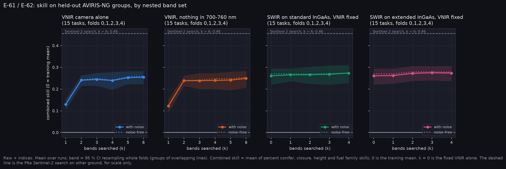

# P6a-HS v3: AVIRIS-NG band searches, all lines and all folds (E-61, E-62)

Run on Nibi: `narval_results/hs_v3/20261101-2024`, 75 of 75 tasks. Pack `aviris_v3`: 42 lines, 1,087,281 development pixels, SCANFI 2020 labels, with sensor noise. The AVIRIS test set was not transferred.

**These verdicts are provisional until `hs_v4` confirms them.** `aviris_v4` moved 1.62 % of family labels (bryoid from NF to O) and left percent conifer, closure and height unchanged. E-61 and E-62 are registered on those three targets, so little should change, but the family head trains alongside them.

**At a glance:** [experiments.md](experiments.md). Tables and options: [tables.md](tables.md).

Generated with:

```bash
python scripts/make_results_package.py --phase P6hs --run narval_results/hs_v3/20261101-2024 --out docs/results/p6a_hs_v3
python scripts/make_experiment_qual.py --only E-61 E-62 --hs-run narval_results/hs_v3/20261101-2024 \
    --hs-pack ../Fire_Risk_Model/data/aviris_v3/dev.npz --hs-out docs/results/p6a_hs_v3
python scripts/make_phase_docs.py --phase P6a-HS-v3
```



## E-61: extended against standard InGaAs. The falsifier does not fire

| Target | RMSE removed, standard k = 4 | Extended k = 4 | Extra from extended [95 % CI] |
|---|---|---|---|
| Percent conifer | 0.34 % | 0.10 % | −0.24 [−0.56, +0.08] |
| Crown closure | 0.44 % | 0.50 % | +0.06 [−0.03, +0.17] |
| Canopy height | 0.03 m | 0.07 m | +0.04 [−0.01, +0.09] |

- **As registered, E-61 holds.** No target's extra gain has a CI excluding 0.
- **The gains are small in both arms.** Searched SWIR adds +0.013 of combined skill over the fixed VNIR.
- **The searches didn't find the best set.** Config C, a hand-set pair (1610 and 2190 nm), scores highest at 0.277. Its height RMSE beats the searched standard set by 0.096 m [0.001, 0.251]. Against config A, adding 2190 nm improves height by 0.13 m [0.09, 0.19] and closure by 0.31 % [0.04, 0.65]. So "extended adds nothing" holds for these searches, not for 2190 nm itself, and config C pays for it on percent conifer: 0.72 % worse than searched standard [0.23, 1.27].
- **The searches disagree with each other.** Picks are unstable in both arms, the least-chosen region appearing in 47 % (standard) and 27 % (extended) of searches. That fails P12's pick rule of 4 in 6 folds.

## E-62: red edge. The falsifier fires

- **Without 700-760 nm, the best 6-band VNIR set is within 5 % on both targets:** percent conifer −1.2 % [−2.9, +0.1], closure +2.2 % [−0.3, +5.6]. Height, not registered, is +2.3 % [0.0, +6.0].
- **The best sets still prefer it.** A 700-760 nm band is in 12 of 15 best sets, so the first half of the hypothesis holds and the second doesn't.
- **This matches the Sentinel-2 half** (E-62 in `p6a_ecology`: +0.9 %, −0.2 %).
- **The VNIR search stalls.** Skill barely rises past k = 2 (0.241 to 0.254), and the fixed six VNIR bands score 0.261, better than any searched VNIR set, by 0.007 at k = 6 [−0.002, +0.013].

## What the sets score

| Set | Combined skill | Above fixed VNIR [95 % CI] | Closure RMSE | Height RMSE |
|---|---|---|---|---|
| Config C (1610, 2190) | 0.277 | +0.016 [−0.000, +0.037] | 14.95 | 3.70 |
| Sentinel-2 12 bands | 0.274 | +0.013 [−0.003, +0.027] | 15.07 | 3.78 |
| Mantis MS + SWIR | 0.273 | +0.012 [+0.006, +0.018] | 15.12 | 3.75 |
| Config B (1240, 1375, 1610) | 0.270 | +0.009 [−0.001, +0.019] | 15.10 | 3.75 |
| Config A (1610) | 0.268 | +0.007 [−0.001, +0.015] | 15.26 | 3.83 |
| Fixed VNIR | 0.261 | | 15.75 | 3.83 |

SWIR helps closure in every set here. It doesn't help percent conifer on these labels, and every fixed SWIR set is slightly worse on it. Ground plots show the opposite for percent conifer ([p6a_external_labels](../p6a_external_labels/README.md)).

## Options and cost

`tables.md` lists every option with cost, pros and cons (A-41). Cost is qualitative, as Q6 is open: VNIR low, standard InGaAs moderate, extended InGaAs high.

## Files

| File | What it shows |
|---|---|
| `experiments.png`, `experiments.md` | phase sheet |
| `curves.png`, `selection.png` | skill by nested set, and what each search chose |
| `qual_E-61_*.png`, `qual_E-62_*.png` | held-out line strips per target |
| `tables.md`, `T_options.csv`, `T_targets.csv`, `summary.json` | the numbers |

<!-- qual:start -->
## Qualitative view per experiment

- **E-61** Best SWIR bands, searched broadly (line strips): [qual_E-61_family.png](qual_E-61_family.png), [qual_E-61_pc.png](qual_E-61_pc.png), [qual_E-61_closure.png](qual_E-61_closure.png), [qual_E-61_height.png](qual_E-61_height.png)
- **E-62** Best VNIR bands, searched broadly (line strips): [qual_E-62_family.png](qual_E-62_family.png), [qual_E-62_pc.png](qual_E-62_pc.png), [qual_E-62_closure.png](qual_E-62_closure.png), [qual_E-62_height.png](qual_E-62_height.png)
<!-- qual:end -->
