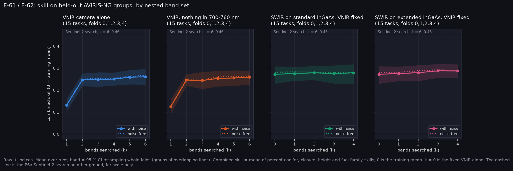

# P6a-HS v4: AVIRIS-NG band searches on the final labels (E-61, E-62)

Run on Nibi: `narval_results/hs_v4/20261102-1959`, 75 of 75 tasks. Pack `aviris_v4`: 42 lines, 1,087,281 development pixels, SCANFI 2020 labels with the A-44 family classes, with sensor noise (placeholder model, A-37). The AVIRIS test set was not transferred. This run replaces `hs_v3` (`../p6a_hs_v3/`) as the reading of E-61 and E-62.

**At a glance:** [experiments.md](experiments.md). Tables and options: [tables.md](tables.md).

Generated with:

```bash
python scripts/make_results_package.py --phase P6hs --run narval_results/hs_v4/20261102-1959 --out docs/results/p6a_hs_v4
python scripts/make_experiment_qual.py --only E-61 E-62 --hs-run narval_results/hs_v4/20261102-1959 \
    --hs-pack ../Fire_Risk_Model/data/aviris_v4/dev.npz --hs-out docs/results/p6a_hs_v4
python scripts/make_phase_docs.py --phase P6a-HS-v4
```



## E-61: extended against standard InGaAs. The falsifier fires, on height only

| Target | RMSE removed, standard k = 4 | Extended k = 4 | Extra from extended [95 % CI] |
|---|---|---|---|
| Percent conifer | 0.22 % | −0.04 % | −0.26 [−0.59, +0.04] |
| Crown closure | 0.28 % | 0.70 % | +0.42 [−0.08, +1.24] |
| Canopy height | −0.01 m | 0.07 m | **+0.09 [+0.01, +0.23]** |

- **As registered, E-61 is refuted.** The extended window improves height by a CI that excludes 0, and by more than 10 % of the standard window's gain.
- **The rule's threshold is degenerate here.** The standard search removed no height error at all (−0.01 m), so any extended gain passes the 10 % test. The gain itself is 0.09 m, about 2 % of the 3.8 m RMSE.
- **Lidar doesn't confirm it.** On ATL08 height (`../p6a_external_labels_v2/`), searched extended is 0.05 m worse than searched standard [−0.11, +0.00]. The searched-set gap may come from SCANFI, which is mapped from Landsat, SWIR2 band included.
- **2190 nm added to 1610 nm helps on both label sources.** Config C against config A gives height −0.12 m [−0.23, −0.05] on SCANFI and −0.07 m [−0.14, −0.02] on lidar, plus closure −0.34 % [−0.77, −0.01] on SCANFI. So the hand-set SWIR2 band carries height information that both label sources see.
- **The searches still disagree.** In the extended arm, the least-chosen region turns up in 27–33 % of searches, and the standard arm reaches 60 % at k = 4. Neither meets P12's 4-in-6 pick rule.

## E-62: red edge. The falsifier fires again

| Target | No red edge minus VNIR, k = 6 [95 % CI] | Folds worse |
|---|---|---|
| Percent conifer | −1.1 % [−2.1, −0.3] | 1/5 |
| Crown closure | +2.1 % [+0.9, +3.3] | 5/5 |
| Canopy height (not registered) | +1.0 % [+0.2, +1.9] | 5/5 |

- **The first half holds:** a 700–760 nm band is in 15 of 15 best 6-band VNIR sets (12 of 15 in `hs_v3`).
- **The second half fails:** without it, the best set is within 5 % on both registered targets. Closure and height are now reliably worse without red edge, but by about 2 %, not 5 %. Percent conifer is slightly better.
- **The VNIR search still stalls:** the searched 6-band VNIR set scores 0.011 below the fixed six VNIR bands [−0.019, −0.003].

## What the sets score

Paired on the same folds and seeds against the fixed six VNIR bands (0.272):

| Set | Combined skill | Above fixed VNIR [95 % CI] | Closure RMSE change | Height RMSE change |
|---|---|---|---|---|
| Config C (1610, 2190) | 0.288 | +0.016 [−0.003, +0.042] | −0.84 % [−1.84, −0.17] | −0.11 m [−0.27, −0.00] |
| Searched extended, k = 4 | 0.287 | +0.015 [+0.004, +0.026] | −0.70 % [−1.21, −0.32] | −0.07 m [−0.15, −0.01] |
| Sentinel-2 12 bands | 0.286 | +0.014 [−0.003, +0.031] | −0.72 % [−1.49, −0.08] | −0.06 m [−0.13, +0.01] |
| Mantis MS + SWIR | 0.285 | +0.013 [+0.003, +0.026] | −0.68 % [−1.22, −0.30] | −0.08 m [−0.18, −0.02] |
| Searched standard, k = 4 | 0.279 | +0.007 [−0.002, +0.015] | −0.28 % [−0.56, +0.06] | +0.01 m [−0.07, +0.10] |
| Config B (1240, 1375, 1610) | 0.278 | +0.006 [−0.004, +0.017] | −0.64 % [−1.18, −0.22] | −0.05 m [−0.15, +0.04] |
| Config A (1610) | 0.278 | +0.006 [−0.005, +0.017] | −0.50 % [−1.09, −0.11] | +0.02 m [−0.05, +0.08] |

- **SWIR helps closure in every set**, with CIs below 0 in all the fixed sets.
- **SWIR doesn't help percent conifer on these labels.** Every fixed SWIR set is slightly worse (config C +0.36 % [+0.01, +0.84]). Ground plots show the opposite: SWIR1 lowers percent-conifer error 1.5 % there. That stays the main open puzzle.
- **The gains are small:** at most +0.016 combined skill, against +0.05 on ground plots.

## Fuel family, per class

`tables.md` has recall and precision per class for three sets. Water is near 0.94 and open ground about 0.6–0.7. Conifer is about 0.52, deciduous 0.3 and mixedwood 0.26. Slash is never predicted: 0.09 % of pixels, and absent from one fold. The family head mostly separates water and open ground from forest, not one forest type from another.

## Options and cost

`tables.md` lists all 29 options with cost, pros and cons (A-41). Cost is qualitative, since Q6 is open: VNIR low, standard InGaAs moderate, extended InGaAs high. Twelve options tie within one SE of the best (config C, 0.288 ± 0.014). They include config A, config B, Mantis MS + SWIR and every searched SWIR set. The fixed VNIR alone is 0.016 below.

## Files

| File | What it shows |
|---|---|
| `experiments.png`, `experiments.md` | phase sheet |
| `curves.png`, `selection.png` | skill by nested set, and what each search chose |
| `qual_E-61_*.png`, `qual_E-62_*.png` | held-out line strips per target |
| `tables.md`, `T_options.csv`, `T_targets.csv`, `T_family.csv`, `summary.json` | the numbers |

<!-- qual:start -->
## Qualitative view per experiment

- **E-61** Best SWIR bands, searched broadly (line strips): [qual_E-61_family.png](qual_E-61_family.png), [qual_E-61_pc.png](qual_E-61_pc.png), [qual_E-61_closure.png](qual_E-61_closure.png), [qual_E-61_height.png](qual_E-61_height.png)
- **E-62** Best VNIR bands, searched broadly (line strips): [qual_E-62_family.png](qual_E-62_family.png), [qual_E-62_pc.png](qual_E-62_pc.png), [qual_E-62_closure.png](qual_E-62_closure.png), [qual_E-62_height.png](qual_E-62_height.png)
<!-- qual:end -->
