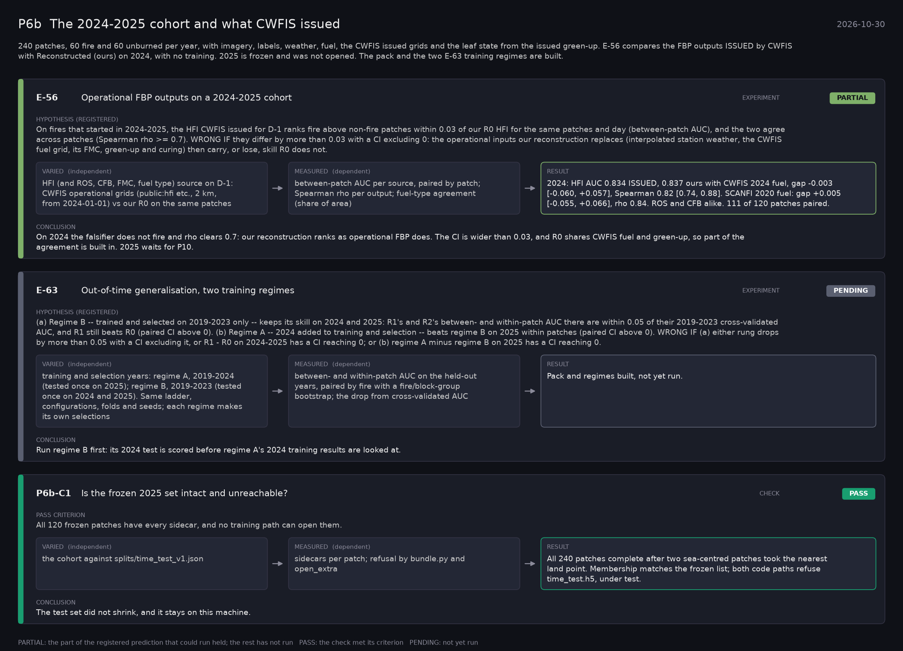

# P6b: The 2024-2025 cohort and what CWFIS issued (2026-10-30)

What this phase ran and concluded. Generated by `scripts/make_phase_docs.py` from `src/safari_bands/phases.py`; registered hypotheses are quoted from the register, verbatim. Full results: [README.md](README.md).

240 patches, 60 fire and 60 unburned per year, with imagery, labels, weather, fuel, the CWFIS issued grids and the leaf state from the issued green-up. E-56 compares the FBP outputs ISSUED by CWFIS with Reconstructed (ours) on 2024, with no training. 2025 is frozen and was not opened. The pack and the two E-63 training regimes are built.

## E-56: Operational FBP outputs on a 2024-2025 cohort (experiment): **PARTIAL**

| | |
|---|---|
| Hypothesis (registered) | On fires that started in 2024-2025, the HFI CWFIS issued for D-1 ranks fire above non-fire patches within 0.03 of our R0 HFI for the same patches and day (between-patch AUC), and the two agree across patches (Spearman rho >= 0.7). WRONG IF they differ by more than 0.03 with a CI excluding 0: the operational inputs our reconstruction replaces (interpolated station weather, the CWFIS fuel grid, its FMC, green-up and curing) then carry, or lose, skill R0 does not. |
| Varied (independent) | HFI (and ROS, CFB, FMC, fuel type) source on D-1: CWFIS operational grids (public:hfi etc., 2 km, from 2024-01-01) vs our R0 on the same patches |
| Measured (dependent) | between-patch AUC per source, paired by patch; Spearman rho per output; fuel-type agreement (share of area) |
| Result | 2024: HFI AUC 0.834 ISSUED, 0.837 ours with CWFIS 2024 fuel, gap -0.003 [-0.060, +0.057], Spearman 0.82 [0.74, 0.88]. SCANFI 2020 fuel: gap +0.005 [-0.055, +0.066], rho 0.84. ROS and CFB alike. 111 of 120 patches paired. |
| Verdict | **PARTIAL**: the part of the registered prediction that could run held; the rest has not run |
| Conclusion | On 2024 the falsifier does not fire and rho clears 0.7: our reconstruction ranks as operational FBP does. The CI is wider than 0.03, and R0 shares CWFIS fuel and green-up, so part of the agreement is built in. 2025 waits for P10. |

## E-63: Out-of-time generalisation, two training regimes (experiment): **PENDING**

| | |
|---|---|
| Hypothesis (registered) | (a) Regime B -- trained and selected on 2019-2023 only -- keeps its skill on 2024 and 2025: R1's and R2's between- and within-patch AUC there are within 0.05 of their 2019-2023 cross-validated AUC, and R1 still beats R0 (paired CI above 0). (b) Regime A -- 2024 added to training and selection -- beats regime B on 2025 within patches (paired CI above 0). WRONG IF (a) either rung drops by more than 0.05 with a CI excluding it, or R1 - R0 on 2024-2025 has a CI reaching 0; or (b) regime A minus regime B on 2025 has a CI reaching 0. |
| Varied (independent) | training and selection years: regime A, 2019-2024 (tested once on 2025); regime B, 2019-2023 (tested once on 2024 and 2025). Same ladder, configurations, folds and seeds; each regime makes its own selections |
| Measured (dependent) | between- and within-patch AUC on the held-out years, paired by fire with a fire/block-group bootstrap; the drop from cross-validated AUC |
| Result | Pack and regimes built, not yet run. |
| Verdict | **PENDING**: not yet run |
| Conclusion | Run regime B first: its 2024 test is scored before regime A's 2024 training results are looked at. |

## P6b-C1: Is the frozen 2025 set intact and unreachable? (check): **PASS**

| | |
|---|---|
| Pass criterion | All 120 frozen patches have every sidecar, and no training path can open them. |
| Varied (independent) | the cohort against splits/time_test_v1.json |
| Measured (dependent) | sidecars per patch; refusal by bundle.py and open_extra |
| Result | All 240 patches complete after two sea-centred patches took the nearest land point. Membership matches the frozen list; both code paths refuse time_test.h5, under test. |
| Verdict | **PASS**: the check met its criterion |
| Conclusion | The test set did not shrink, and it stays on this machine. |
