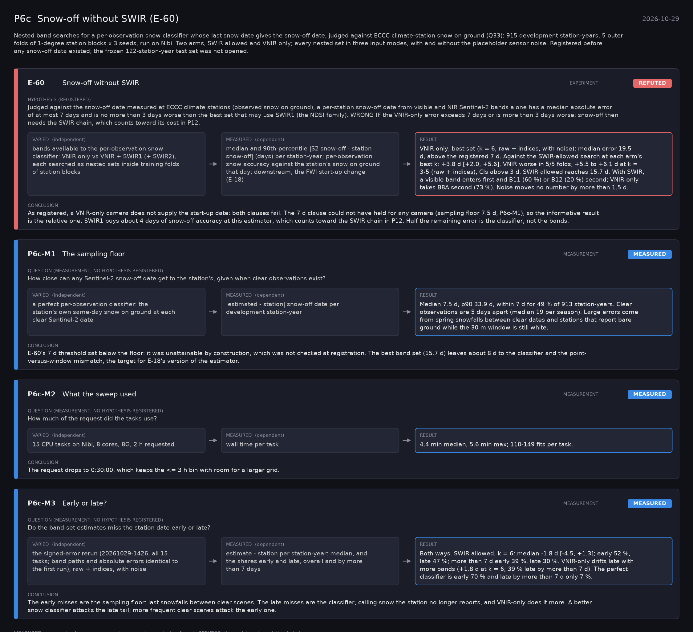

# P6c: Snow-off without SWIR (E-60) (2026-10-29)

What this phase ran and concluded. Generated by `scripts/make_phase_docs.py` from `src/safari_bands/phases.py`; registered hypotheses are quoted from the register, verbatim. Full results: [README.md](README.md).

Nested band searches for a per-observation snow classifier whose last snow date gives the snow-off date, judged against ECCC climate-station snow on ground (Q33): 915 development station-years, 5 outer folds of 1-degree station blocks x 3 seeds, run on Nibi. Two arms, SWIR allowed and VNIR only; every nested set in three input modes, with and without the placeholder sensor noise. Registered before any snow-off data existed; the frozen 122-station-year test set was not opened.

## E-60: Snow-off without SWIR (experiment): **REFUTED**

| | |
|---|---|
| Hypothesis (registered) | Judged against the snow-off date measured at ECCC climate stations (observed snow on ground), a per-station snow-off date from visible and NIR Sentinel-2 bands alone has a median absolute error of at most 7 days and is no more than 3 days worse than the best set that may use SWIR1 (the NDSI family). WRONG IF the VNIR-only error exceeds 7 days or is more than 3 days worse: snow-off then needs the SWIR chain, which counts toward its cost in P12. |
| Varied (independent) | bands available to the per-observation snow classifier: VNIR only vs VNIR + SWIR1 (+ SWIR2), each searched as nested sets inside training folds of station blocks |
| Measured (dependent) | median and 90th-percentile |S2 snow-off - station snow-off| (days) per station-year; per-observation snow accuracy against the station's snow on ground that day; downstream, the FWI start-up change (E-18) |
| Result | VNIR only, best set (k = 6, raw + indices, with noise): median error 19.5 d, above the registered 7 d. Against the SWIR-allowed search at each arm's best k: +3.8 d [+2.0, +5.6], VNIR worse in 5/5 folds; +5.5 to +6.1 d at k = 3-5 (raw + indices), CIs above 3 d. SWIR allowed reaches 15.7 d. With SWIR, a visible band enters first and B11 (60 %) or B12 (20 %) second; VNIR-only takes B8A second (73 %). Noise moves no number by more than 1.5 d. |
| Verdict | **REFUTED**: the registered prediction failed |
| Conclusion | As registered, a VNIR-only camera does not supply the start-up date: both clauses fail. The 7 d clause could not have held for any camera (sampling floor 7.5 d, P6c-M1), so the informative result is the relative one: SWIR1 buys about 4 days of snow-off accuracy at this estimator, which counts toward the SWIR chain in P12. Half the remaining error is the classifier, not the bands. |

## P6c-M1: The sampling floor (measurement): **MEASURED**

| | |
|---|---|
| Question (measurement; no hypothesis registered) | How close can any Sentinel-2 snow-off date get to the station's, given when clear observations exist? |
| Varied (independent) | a perfect per-observation classifier: the station's own same-day snow on ground at each clear Sentinel-2 date |
| Measured (dependent) | |estimated - station| snow-off date per development station-year |
| Result | Median 7.5 d, p90 33.9 d, within 7 d for 49 % of 913 station-years. Clear observations are 5 days apart (median 19 per season). Large errors come from spring snowfalls between clear dates and stations that report bare ground while the 30 m window is still white. |
| Verdict | **MEASURED**: no hypothesis: a measurement or control, reported as found |
| Conclusion | E-60's 7 d threshold sat below the floor: it was unattainable by construction, which was not checked at registration. The best band set (15.7 d) leaves about 8 d to the classifier and the point-versus-window mismatch, the target for E-18's version of the estimator. |

## P6c-M2: What the sweep used (measurement): **MEASURED**

| | |
|---|---|
| Question (measurement; no hypothesis registered) | How much of the request did the tasks use? |
| Varied (independent) | 15 CPU tasks on Nibi, 8 cores, 8G, 2 h requested |
| Measured (dependent) | wall time per task |
| Result | 4.4 min median, 5.6 min max; 110-149 fits per task. |
| Verdict | **MEASURED**: no hypothesis: a measurement or control, reported as found |
| Conclusion | The request drops to 0:30:00, which keeps the <= 3 h bin with room for a larger grid. |

## P6c-M3: Early or late? (measurement): **MEASURED**

| | |
|---|---|
| Question (measurement; no hypothesis registered) | Do the band-set estimates miss the station date early or late? |
| Varied (independent) | the signed-error rerun (20261029-1426, all 15 tasks; band paths and absolute errors identical to the first run); raw + indices, with noise |
| Measured (dependent) | estimate - station per station-year: median, and the shares early and late, overall and by more than 7 days |
| Result | Both ways. SWIR allowed, k = 6: median -1.8 d [-4.5, +1.3]; early 52 %, late 47 %; more than 7 d early 39 %, late 30 %. VNIR-only drifts late with more bands (+1.8 d at k = 6; 39 % late by more than 7 d). The perfect classifier is early 70 % and late by more than 7 d only 7 %. |
| Verdict | **MEASURED**: no hypothesis: a measurement or control, reported as found |
| Conclusion | The early misses are the sampling floor: last snowfalls between clear scenes. The late misses are the classifier, calling snow the station no longer reports, and VNIR-only does it more. A better snow classifier attacks the late tail; more frequent clear scenes attack the early one. |
