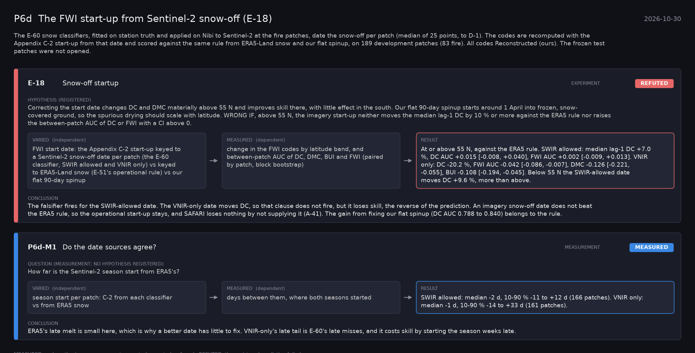

# P6d: The FWI start-up from Sentinel-2 snow-off (E-18) (2026-10-30)

What this phase ran and concluded. Generated by `scripts/make_phase_docs.py` from `src/safari_bands/phases.py`; registered hypotheses are quoted from the register, verbatim. Full results: [README.md](README.md).

The E-60 snow classifiers, fitted on station truth and applied on Nibi to Sentinel-2 at the fire patches, date the snow-off per patch (median of 25 points, to D-1). The codes are recomputed with the Appendix C-2 start-up from that date and scored against the same rule from ERA5-Land snow and our flat spinup, on 189 development patches (83 fire). All codes Reconstructed (ours). The frozen test patches were not opened.

## E-18: Snow-off startup (experiment): **REFUTED**

| | |
|---|---|
| Hypothesis (registered) | Correcting the start date changes DC and DMC materially above 55 N and improves skill there, with little effect in the south. Our flat 90-day spinup starts around 1 April into frozen, snow-covered ground, so the spurious drying should scale with latitude. WRONG IF, above 55 N, the imagery start-up neither moves the median lag-1 DC by 10 % or more against the ERA5 rule nor raises the between-patch AUC of DC or FWI with a CI above 0. |
| Varied (independent) | FWI start date: the Appendix C-2 start-up keyed to a Sentinel-2 snow-off date per patch (the E-60 classifier, SWIR allowed and VNIR only) vs keyed to ERA5-Land snow (E-51's operational rule) vs our flat 90-day spinup |
| Measured (dependent) | change in the FWI codes by latitude band, and between-patch AUC of DC, DMC, BUI and FWI (paired by patch, block bootstrap) |
| Result | At or above 55 N, against the ERA5 rule. SWIR allowed: median lag-1 DC +7.0 %, DC AUC +0.015 [-0.008, +0.040], FWI AUC +0.002 [-0.009, +0.013]. VNIR only: DC -20.2 %, FWI AUC -0.042 [-0.086, -0.007], DMC -0.126 [-0.221, -0.055], BUI -0.108 [-0.194, -0.045]. Below 55 N the SWIR-allowed date moves DC +9.6 %, more than above. |
| Verdict | **REFUTED**: the registered prediction failed |
| Conclusion | The falsifier fires for the SWIR-allowed date. The VNIR-only date moves DC, so that clause does not fire, but it loses skill, the reverse of the prediction. An imagery snow-off date does not beat the ERA5 rule, so the operational start-up stays, and SAFARI loses nothing by not supplying it (A-41). The gain from fixing our flat spinup (DC AUC 0.788 to 0.840) belongs to the rule. |

## P6d-M1: Do the date sources agree? (measurement): **MEASURED**

| | |
|---|---|
| Question (measurement; no hypothesis registered) | How far is the Sentinel-2 season start from ERA5's? |
| Varied (independent) | season start per patch: C-2 from each classifier vs from ERA5 snow |
| Measured (dependent) | days between them, where both seasons started |
| Result | SWIR allowed: median -2 d, 10-90 % -11 to +12 d (166 patches). VNIR only: median -1 d, 10-90 % -14 to +33 d (161 patches). |
| Verdict | **MEASURED**: no hypothesis: a measurement or control, reported as found |
| Conclusion | ERA5's late melt is small here, which is why a better date has little to fix. VNIR-only's late tail is E-60's late misses, and it costs skill by starting the season weeks late. |
