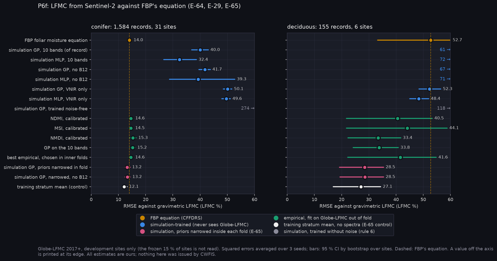
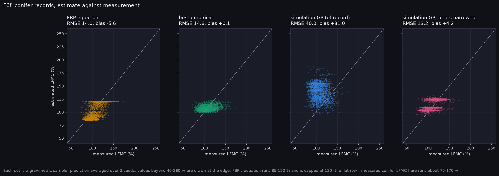
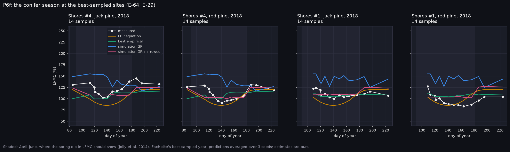

# P6f-v2: LFMC with priors narrowed inside each fold (E-65)

Run on Narval: `narval_results/lfmc_v2/20261106-1201`, 3 seeds, complete. Globe-LFMC 2017+, development sites only (1,739 records at 37 sites); the frozen 15 % of sites was not read. The design is A-51: in each outer site fold the `lfmc_v1` simulation pool is cut to the LFMC range of that fold's training records, by species and season, and the GP is refit on it. `prior_mean_fold`, the training stratum's mean, is the control. Every v1 arm reran in the same job, and its numbers match v1's exactly. All values are Reconstructed (ours).

**At a glance:** [experiments.md](experiments.md). Tables: [tables.md](tables.md). Step 1 of the fix, the reference check, is in [p6f_reference](../p6f_reference/README.md).

```bash
python scripts/make_results_package.py --phase P6f2 --run narval_results/lfmc_v2/20261106-1201
python scripts/make_phase_docs.py --phase P6f-v2
```



## What it found

On conifer records (1,584 at 31 sites):

| model | RMSE | bias |
|---|---|---|
| FBP foliar moisture equation | 14.0 | −5.6 |
| simulation GP, wide prior (v1, of record) | 40.0 | +31.0 |
| **simulation GP, priors narrowed in fold** | **13.2** | **+4.2** |
| simulation GP, narrowed, no B12 | 13.2 | +4.1 |
| best empirical (inner-fold choice) | 14.6 | +0.1 |
| **training stratum mean (control, no spectra)** | **12.1** | **+0.1** |

**E-65 is MIXED.** Registered clauses:
1. **Bias within ±10: SUPPORTED.** +4.2, down from +31. The v1 bias was the prior: 60–250 % LFMC against a measured 80–149 %.
2. **Beats the stratum mean: REFUTED.** The narrowed GP is *worse* than the control by +1.09 [+0.59, +1.60]. On Sentinel-2's bands under PROSPECT-D + 4SAIL, the spectra add nothing to LFMC beyond the species-and-season prior. They add a little noise.
3. **Beats FBP's equation: SUPPORTED, narrowly.** −0.80 [−1.66, −0.01]. But the stratum mean beats FBP by more, −1.89 [−2.57, −1.21], so the gain comes from the prior, not the imagery.
4. **Loses skill without B12: REFUTED.** +0.07 [−0.02, +0.21]. With no spectral skill left, no band matters.



## What this means

- **For T1 (live fuel moisture) and the band decision.** Neither simulation route (wide or narrowed prior) nor the empirical calibration extracts LFMC from Sentinel-2 bands on conifers. Moisture therefore adds no band requirement on current evidence (1240 nm stays unjustified). E-29's B12 signal disappears once the prior is right.
- **A by-product worth keeping.** A species-by-season mean, learned out of fold from Globe-LFMC, beats FBP's foliar moisture equation by about 1.9 points (12.1 against 14.0). It needs a fuel-type map (which the onboard ecology network supplies) and a calendar, not moisture bands. That bears on G1 (FMC is computed, never observed), and could be offered as an option in P12.
- **What could still change the answer** (steps 3–4 of A-51): moss and lichen backgrounds, and a discontinuous canopy model for conifer stands. James's own LFMC and dry-matter sampling would test the dry-matter half of H1 directly.



## Limits

- Globe-LFMC has no Canadian sites; US jack and red pine are the analogues. Black spruce has 16 records, so there is no C-2 claim.
- Pairing is ±5 days, nearest clear Sentinel-2 date; placeholder sensor noise.
- Deciduous (155 records, 6 sites) is reported, not tested; there too the stratum mean (10.9) leads.

<!-- qual:start -->
## Qualitative view per experiment

- **E-65** LFMC: simulation retrieval with fold-wise narrowed priors (P6f-v2) (site series): [qual_E-64_series.png](qual_E-64_series.png)
<!-- qual:end -->
