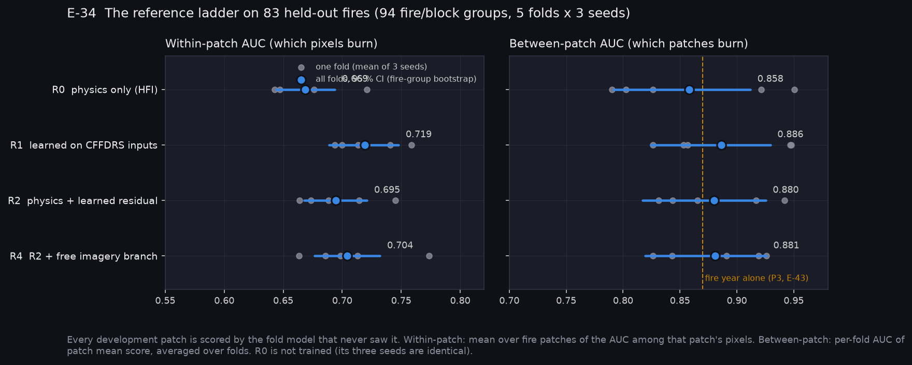
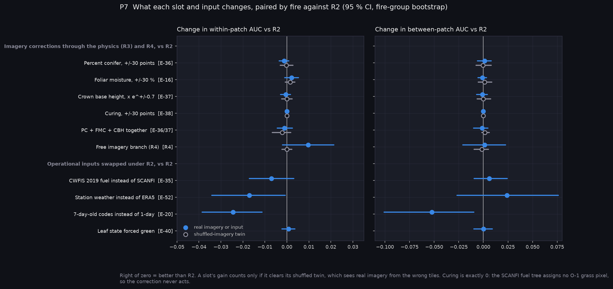
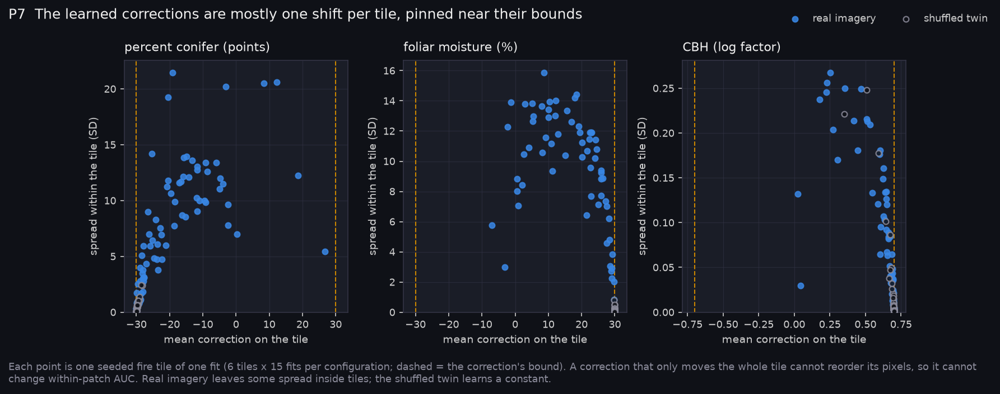
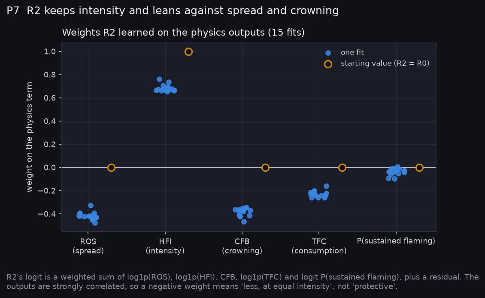
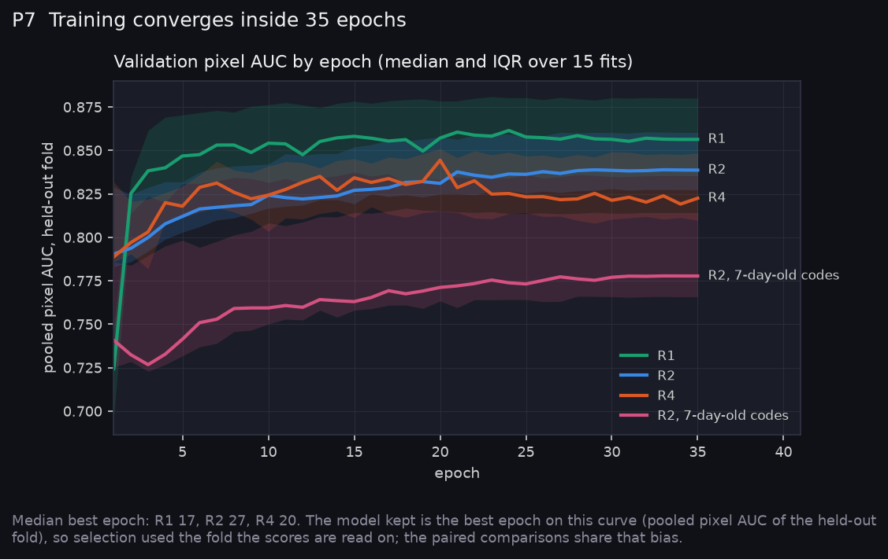
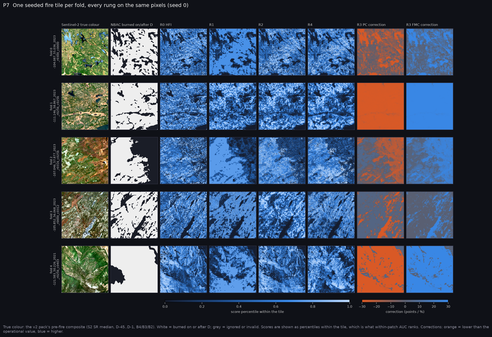

# P7: Stage A slot experiments, first sweep (2026-10-26)

The P5 ladder ran on Narval as sweep `slots_v2` (job 7289478): 20 configurations × 5 fire-aware folds × 3 seeds, 300 fits, all completed.

**How the results are read**
- **Held-out scoring.** Every development patch is scored by the fold model that never trained on it.
- **Paired comparisons.** Configurations are compared fire by fire: 83 fires in 94 fire/block groups, with CIs from a bootstrap over whole groups.
- **What did not run.** Only the *correct* form of each imagery slot ran; the *replace* forms wait for the P6 estimators. The test split was not read.

**At a glance:** [experiments.md](experiments.md). Tables: [tables.md](tables.md). Rebuild with `python scripts/make_results_package.py --phase P7 --run narval_results/slots_v2/7289478`.

## The ladder (E-34): MIXED



| Rung | Within-patch AUC | Between-patch AUC | Between, same-year pairs |
|---|---|---|---|
| R0 physics (HFI) | 0.669 | 0.858 | 0.806 |
| R1 learned on CFFDRS inputs | 0.719 | 0.886 | 0.840 |
| R2 physics + residual | 0.695 | 0.880 | 0.846 |
| R4 R2 + free imagery | 0.704 | 0.881 | 0.835 |

- **R1 beats R0 where it matters most:** +0.051 [+0.034, +0.068] within patches, in all five folds. The falsifier did not fire.
- **R2 is not within noise of R1 inside patches:** −0.025 [−0.034, −0.015], 0 of 5 folds. Between patches the two match (−0.006, CI spans 0).
  - R2's residual is the same network as R1, so the gap is the cost of anchoring the score to the physics (Q29).
- **Year and between-patch scores.** Between-patch numbers sit near what the fire year alone gives (0.87, E-43). Restricted to same-year pairs, every rung drops by 0.03–0.05, but the order holds.

## Slots and inputs against R2



**Imagery corrections (R3).** None moves skill, and none differs from its shuffled twin.

| Slot | Δ within vs R2 | vs its twin | Verdict |
|---|---|---|---|
| Percent conifer ±30 | −0.001 [−0.004, +0.001] | −0.001 | E-36 AT RISK |
| Foliar moisture ±30 % | +0.002 [−0.001, +0.005] | +0.001 | E-16 (no hypothesis) |
| CBH × e^±0.7 | −0.0005 [−0.003, +0.002] | −0.0005 | E-37 AT RISK |
| Curing ±30 | exactly 0 | exactly 0 | E-38 not tested |
| PC + FMC + CBH | −0.001 [−0.004, +0.003] | +0.001 | — |
| R4 free branch | +0.010 [−0.002, +0.021] | +0.010 [−0.002, +0.021] | measured |

- **Curing never acted.** The SCANFI fuel tree assigns no O-1 pixel, so its correction stayed at zero. CWFIS 2019 fuel has O-1b on 4.6 % of pixels.
- **E-37's falsifier did not fire:** CFB is above 0 on 47 % of burnable pixels. Crowning engages, but a learned CBH still does not move skill.
- **All the imagery R4 can add here** is about +0.01 within patches, and at 83 fires that cannot be separated from zero.

**Operational inputs swapped under R2:**
- **Fuel inventory (E-35):** CWFIS 2019 instead of SCANFI costs −0.007 [−0.017, +0.003] within, against −0.048 under R0. Learning absorbs most of the inventory gap.
- **Weather source (E-52):** station weather is −0.017 [−0.034, −0.001] within and +0.024 [−0.027, +0.076] between.
- **Stale codes (E-20, PARTIAL):** 7-day-old codes cost −0.024 within and −0.052 [−0.101, −0.010] between, in all five folds. Decay is not flat. The per-code ordering and the score-at-each-lag design have not run.
- **Green-up (E-40):** forcing leaf state green changes nothing (+0.001), so the CWFIS green-up product adds nothing measurable here.

## Why the corrections do nothing (P7-C1, added after registration)



**Each correction learned one shift per tile, mostly near its bound:**

| Slot | Real imagery: tile mean | Real imagery: SD within tile | Shuffled twin: tile mean | Shuffled twin: SD within tile |
|---|---|---|---|---|
| Percent conifer | −24 points | 6 | −29.9 points | 0.3 |
| Foliar moisture | +24 % | 8 | +30 % | 0.1 |
| CBH | × e^0.69 | 0.04 | × e^0.70 | 0.004 |

A shift applied to a whole tile can't reorder its pixels, so it can't change within-patch AUC.

**All three shifts point the same way: less crown fire at equal intensity.** R2's own weights agree:



R2 keeps HFI (+0.67) and leans against ROS (−0.42), CFB (−0.37) and TFC (−0.23). The outputs are collinear, so read these as "less, at equal intensity", not as protective effects.

**So the corrections are recalibrating the physics, not bringing information from the imagery.** Q29 proposes giving each slot an imagery-free offset so the imagery can only explain spatial deviation. That would be registered as a new arm.

## Training and tiles



- **Training converges inside 35 epochs.** Median best epoch: R1 17, R2 27, R4 20.
- **Selection bias, shared by every arm.** The kept epoch is chosen on the held-out fold's pooled pixel AUC, so all levels are slightly optimistic. The paired comparisons share that bias.



## Resources and the next sweep

Measured cost:

| Fit type | Time per fit |
|---|---|
| R0 | 13–16 s |
| Trained fits | median 3.4 min, max 4.1 min |

The whole sweep was about 15 GPU-hours. Each task had reserved 3 h.

What changed in `Fire_Risk_FW/scripts/shell/sweep_slots.sh` (A-35):

- **Request per task:** 0:30:00, one A100, 12 CPUs, 16G.
- **Fits per task:** 3, on one environment build and one staging (`FITS_PER_TASK`).
- **Chained sub-arrays:** 20 tasks each, each starting after the previous one ends (`afterany`). `PARALLEL=n` caps running tasks.
- **R0 at seed 0 only.**
- **One output tree per sweep:** `$EXP_NAME/$RUN_ID/`. `SKIP_DONE=1` resubmits only missing fits.
- **Resource monitor on:** `resource_usage.csv` per task, so the next sweep measures GPU and RAM.
- **Per-fuel-family scores** in `run_slots.py`, for E-36's M-1/M-2 and E-38's O-1 outcomes.

```bash
bash scripts/shell/sweep_slots.sh                          # dry run: 280 fits, 94 tasks, 5 sub-arrays
SUBMIT=1 bash scripts/shell/sweep_slots.sh                 # the chain
SUBMIT=1 RUN_ID=<id> SKIP_DONE=1 bash scripts/shell/sweep_slots.sh   # fill gaps
```

Before the next full sweep, Q29 asks three things:
- whether to run curing on CWFIS fuel;
- whether to add an imagery-free offset per slot;
- what to do about R2's gap to R1.
