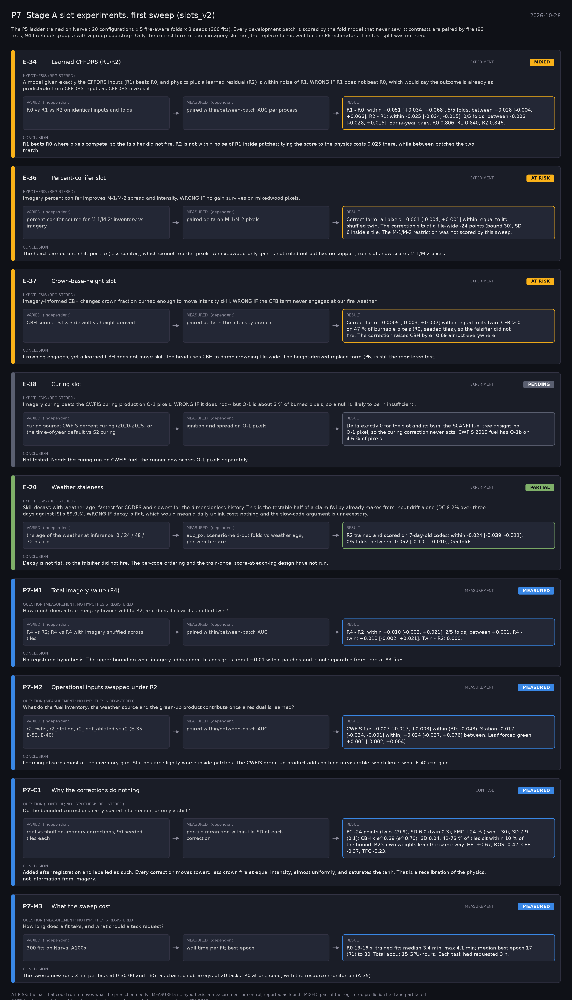

# P7: Stage A slot experiments, first sweep (slots_v2) (2026-10-26)

What this phase ran and concluded. Generated by `scripts/make_phase_docs.py` from `src/safari_bands/phases.py`; registered hypotheses are quoted from the register, verbatim. Full results: [README.md](README.md).

The P5 ladder trained on Narval: 20 configurations x 5 fire-aware folds x 3 seeds (300 fits). Every development patch is scored by the fold model that never saw it; contrasts are paired by fire (83 fires, 94 fire/block groups) with a group bootstrap. Only the correct form of each imagery slot ran; the replace forms wait for the P6 estimators. The test split was not read.

## E-34: Learned CFFDRS (R1/R2) (experiment): **MIXED**

| | |
|---|---|
| Hypothesis (registered) | A model given exactly the CFFDRS inputs (R1) beats R0, and physics plus a learned residual (R2) is within noise of R1. WRONG IF R1 does not beat R0, which would say the outcome is already as predictable from CFFDRS inputs as CFFDRS makes it. |
| Varied (independent) | R0 vs R1 vs R2 on identical inputs and folds |
| Measured (dependent) | paired within/between-patch AUC per process |
| Result | R1 - R0: within +0.051 [+0.034, +0.068], 5/5 folds; between +0.028 [-0.004, +0.066]. R2 - R1: within -0.025 [-0.034, -0.015], 0/5 folds; between -0.006 [-0.028, +0.015]. Same-year pairs: R0 0.806, R1 0.840, R2 0.846. |
| Verdict | **MIXED**: part of the registered prediction held and part failed |
| Conclusion | R1 beats R0 where pixels compete, so the falsifier did not fire. R2 is not within noise of R1 inside patches: tying the score to the physics costs 0.025 there, while between patches the two match. |

## E-36: Percent-conifer slot (experiment): **AT RISK**

| | |
|---|---|
| Hypothesis (registered) | Imagery percent conifer improves M-1/M-2 spread and intensity. WRONG IF no gain survives on mixedwood pixels. |
| Varied (independent) | percent-conifer source for M-1/M-2: inventory vs imagery |
| Measured (dependent) | paired delta on M-1/M-2 pixels |
| Result | Correct form, all pixels: -0.001 [-0.004, +0.001] within, equal to its shuffled twin. The correction sits at a tile-wide -24 points (bound 30), SD 6 inside a tile. The M-1/M-2 restriction was not scored by this sweep. |
| Verdict | **AT RISK**: the half that could run removes what the prediction needs |
| Conclusion | The head learned one shift per tile (less conifer), which cannot reorder pixels. A mixedwood-only gain is not ruled out but has no support; run_slots now scores M-1/M-2 pixels. |

## E-37: Crown-base-height slot (experiment): **AT RISK**

| | |
|---|---|
| Hypothesis (registered) | Imagery-informed CBH changes crown fraction burned enough to move intensity skill. WRONG IF the CFB term never engages at our fire weather. |
| Varied (independent) | CBH source: ST-X-3 default vs height-derived |
| Measured (dependent) | paired delta in the intensity branch |
| Result | Correct form: -0.0005 [-0.003, +0.002] within, equal to its twin. CFB > 0 on 47 % of burnable pixels (R0, seeded tiles), so the falsifier did not fire. The correction raises CBH by e^0.69 almost everywhere. |
| Verdict | **AT RISK**: the half that could run removes what the prediction needs |
| Conclusion | Crowning engages, yet a learned CBH does not move skill: the head uses CBH to damp crowning tile-wide. The height-derived replace form (P6) is still the registered test. |

## E-38: Curing slot (experiment): **PENDING**

| | |
|---|---|
| Hypothesis (registered) | Imagery curing beats the CWFIS curing product on O-1 pixels. WRONG IF it does not -- but O-1 is about 3 % of burned pixels, so a null is likely to be 'n insufficient'. |
| Varied (independent) | curing source: CWFIS percent curing (2020-2025) or the time-of-year default vs S2 curing |
| Measured (dependent) | ignition and spread on O-1 pixels |
| Result | Delta exactly 0 for the slot and its twin: the SCANFI fuel tree assigns no O-1 pixel, so the curing correction never acts. CWFIS 2019 fuel has O-1b on 4.6 % of pixels. |
| Verdict | **PENDING**: not yet run |
| Conclusion | Not tested. Needs the curing run on CWFIS fuel; the runner now scores O-1 pixels separately. |

## E-20: Weather staleness (experiment): **PARTIAL**

| | |
|---|---|
| Hypothesis (registered) | Skill decays with weather age, fastest for CODES and slowest for the dimensionless history. This is the testable half of a claim fwi.py already makes from input drift alone (DC 8.2% over three days against ISI's 89.9%). WRONG IF decay is flat, which would mean a daily uplink costs nothing and the slow-code argument is unnecessary. |
| Varied (independent) | the age of the weather at inference: 0 / 24 / 48 / 72 h / 7 d |
| Measured (dependent) | auc_px, scenario-held-out folds vs weather age, per weather arm |
| Result | R2 trained and scored on 7-day-old codes: within -0.024 [-0.039, -0.011], 0/5 folds; between -0.052 [-0.101, -0.010], 0/5 folds. |
| Verdict | **PARTIAL**: the part of the registered prediction that could run held; the rest has not run |
| Conclusion | Decay is not flat, so the falsifier did not fire. The per-code ordering and the train-once, score-at-each-lag design have not run. |

## P7-M1: Total imagery value (R4) (measurement): **MEASURED**

| | |
|---|---|
| Question (measurement; no hypothesis registered) | How much does a free imagery branch add to R2, and does it clear its shuffled twin? |
| Varied (independent) | R4 vs R2; R4 vs R4 with imagery shuffled across tiles |
| Measured (dependent) | paired within/between-patch AUC |
| Result | R4 - R2: within +0.010 [-0.002, +0.021], 2/5 folds; between +0.001. R4 - twin: +0.010 [-0.002, +0.021]. Twin - R2: 0.000. |
| Verdict | **MEASURED**: no hypothesis: a measurement or control, reported as found |
| Conclusion | No registered hypothesis. The upper bound on what imagery adds under this design is about +0.01 within patches and is not separable from zero at 83 fires. |

## P7-M2: Operational inputs swapped under R2 (measurement): **MEASURED**

| | |
|---|---|
| Question (measurement; no hypothesis registered) | What do the fuel inventory, the weather source and the green-up product contribute once a residual is learned? |
| Varied (independent) | r2_cwfis, r2_station, r2_leaf_ablated vs r2 (E-35, E-52, E-40) |
| Measured (dependent) | paired within/between-patch AUC |
| Result | CWFIS fuel -0.007 [-0.017, +0.003] within (R0: -0.048). Station -0.017 [-0.034, -0.001] within, +0.024 [-0.027, +0.076] between. Leaf forced green +0.001 [-0.002, +0.004]. |
| Verdict | **MEASURED**: no hypothesis: a measurement or control, reported as found |
| Conclusion | Learning absorbs most of the inventory gap. Stations are slightly worse inside patches. The CWFIS green-up product adds nothing measurable, which limits what E-40 can gain. |

## P7-C1: Why the corrections do nothing (control): **MEASURED**

| | |
|---|---|
| Question (control; no hypothesis registered) | Do the bounded corrections carry spatial information, or only a shift? |
| Varied (independent) | real vs shuffled-imagery corrections, 90 seeded tiles each |
| Measured (dependent) | per-tile mean and within-tile SD of each correction |
| Result | PC -24 points (twin -29.9), SD 6.0 (twin 0.3); FMC +24 % (twin +30), SD 7.9 (0.1); CBH x e^0.69 (e^0.70), SD 0.04. 42-73 % of tiles sit within 10 % of the bound. R2's own weights lean the same way: HFI +0.67, ROS -0.42, CFB -0.37, TFC -0.23. |
| Verdict | **MEASURED**: no hypothesis: a measurement or control, reported as found |
| Conclusion | Added after registration and labelled as such. Every correction moves toward less crown fire at equal intensity, almost uniformly, and saturates the tanh. That is a recalibration of the physics, not information from imagery. |

## P7-M3: What the sweep cost (measurement): **MEASURED**

| | |
|---|---|
| Question (measurement; no hypothesis registered) | How long does a fit take, and what should a task request? |
| Varied (independent) | 300 fits on Narval A100s |
| Measured (dependent) | wall time per fit; best epoch |
| Result | R0 13-16 s; trained fits median 3.4 min, max 4.1 min; median best epoch 17 (R1) to 30. Total about 15 GPU-hours. Each task had requested 3 h. |
| Verdict | **MEASURED**: no hypothesis: a measurement or control, reported as found |
| Conclusion | The sweep now runs 3 fits per task at 0:30:00 and 16G, as chained sub-arrays of 20 tasks, R0 at one seed, with the resource monitor on (A-35). |
