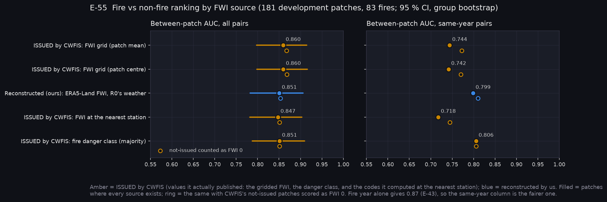
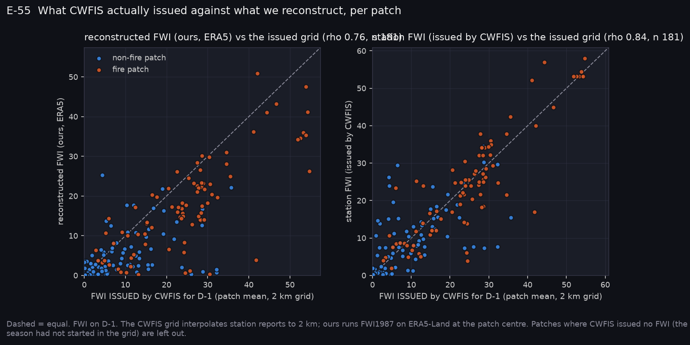
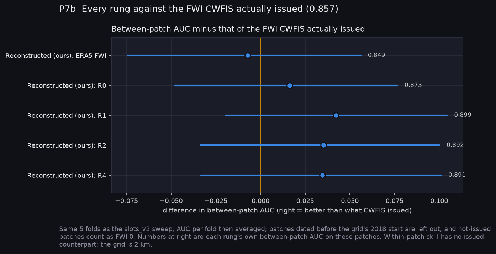

# P7b: Against what CWFIS actually issued (E-55, 2026-10-26)

> **Which CFFDRS is which in this note.**
> - **ISSUED by CWFIS**: values CWFIS actually published. That is the daily FWI grid, the fire danger class, and the FWI codes CWFIS computed at the nearest station.
> - **Reconstructed (ours)**: CFFDRS as we compute it. That is FWI1987 on ERA5-Land, and R0 to R4, which are all our models.
> - Every comparison below says which side it is on.

Until now, every "CFFDRS" number in this study was our reconstruction (R0). This phase is the first comparison with the values CWFIS actually issued.

**The source.** The issued FWI and fire danger grids for each development patch's D−1 come from the CWFIS GeoServer's time-enabled WCS (`Fire_Risk_Model/scripts/python/fetch_cwfis_grids.py`).

**What CWFIS has archived** (GetCapabilities, 2026-10-26):

| Grid | Archived from |
|---|---|
| Issued FWI and danger class | 2018 |
| Issued FFMC, DMC, DC, ISI, BUI and every FBP output | 2024 |

That leaves:
- **FWI only.** For our 2019–2023 fires, the only issued values available are the FWI and the danger class. A comparison with issued FBP outputs waits for E-56's 2024–2025 cohort, or for Q30.
- **Between patches only.** All grids are 2 km and a patch is about 11 km, so no issued value exists for any within-patch result.

**Registration.** E-55 was registered in commit `9f76480`, before any issued value was scored. The frozen test patches were never requested.

**At a glance:** [experiments.md](experiments.md). Tables: [tables.md](tables.md). Rebuild with `python scripts/make_results_package.py --phase P7b --run narval_results/slots_v2/7289478`.

## Coverage

| Patches | n |
|---|---|
| Development patches | 194 |
| Dated before the archive (2016–2017 confusers) | 6 |
| Covered, but CWFIS issued no FWI (April to mid-May; the issued grid's season had not started; whole tile empty) | 7 |
| **Scored: issued grid, issued station FWI and our ERA5 FWI all present** | **181 (83 fires)** |

Patches with no issued FWI are left out of the primary result. A sensitivity check scores them as FWI 0, which is what an operator would have seen.

## E-55: MIXED

| FWI source on D−1 | Between-patch AUC | Same-year pairs |
|---|---|---|
| **ISSUED by CWFIS**: FWI grid (patch mean) | 0.860 [0.798, 0.915] | 0.744 |
| **Reconstructed (ours)**: ERA5-Land FWI | 0.851 [0.783, 0.906] | 0.799 |
| **ISSUED by CWFIS**: FWI at the nearest station | 0.847 [0.782, 0.903] | 0.718 |
| **ISSUED by CWFIS**: fire danger class | 0.851 [0.788, 0.910] | 0.806 |

- **Ranking: held.** Reconstructed minus issued is −0.009 [−0.073, +0.057], inside the registered 0.03. Scoring not-issued patches as 0 gives the issued grid 0.868, about the same.
- **Agreement: failed.** Spearman ρ between our FWI and the issued FWI is 0.76 [0.63, 0.85], under the registered 0.8. Ours runs a median 3.6 FWI lower. The issued station FWI tracks the issued grid more closely (ρ 0.84, median difference 0), as expected, since CWFIS builds the grid from station reports.
- **Same-year pairs reverse the order.** Within a year, the FWI CWFIS issued ranks patches worse than our reconstruction (0.744 vs 0.799). The issued danger class does best (0.806). Much of the issued grid's all-pairs AUC is the fire year (year alone: 0.87, E-43).

**Where our reconstruction departs from what CWFIS issued** (P7b-C1, added after registration). 19 patches have an issued FWI above 10 and a reconstructed FWI below 3:

| Cause | Patches | Detail |
|---|---|---|
| Rain in ERA5 that the station didn't report | 10 | More than 2 mm in the ERA5 cell against about 0 at the station. Our FFMC 46–75 against the issued station FFMC 85–91. |
| Late season start | 4 | Our snow rule hadn't started the season; CWFIS was already issuing FWI 11–32. |
| FFMC differences | 5 | — |

The departures come from our weather inputs, not from the FWI equations, which match the `cffdrs` R package.

## Every rung against what CWFIS issued (P7b-M1)

Same five folds as the sweep, between patches, paired by fold and group. The FWI **ISSUED by CWFIS** scores 0.857. Every row below is our model (**reconstructed**):

| Rung (ours) | Between-patch AUC | Minus issued FWI |
|---|---|---|
| ERA5 FWI | 0.849 | −0.007 [−0.074, +0.056] |
| R0 HFI | 0.873 | +0.016 [−0.048, +0.077] |
| R1 | 0.899 | +0.042 [−0.020, +0.104] |
| R2 | 0.892 | +0.035 [−0.034, +0.100] |
| R4 | 0.891 | +0.035 [−0.033, +0.101] |

At 83 fires, none of our rungs separates from the FWI CWFIS actually issued, between patches. The P7 ladder now carries the issued FWI as an amber reference line.

## What this changes

- **Imagery deltas stand.** Our reconstruction ranks patches the way the issued FWI does, so the imagery deltas in P7, which are measured against our R2, are not measured against an artificially weak baseline.
- **The station is the closer reference.** Where values matter rather than ranks (thresholds, danger classes, staleness), the issued station or grid values are closer to what operations saw than our ERA5 reconstruction.
- **Two follow-ups are worth registering:**
  - an ERA5 rain correction or a minimum-rain threshold;
  - a season start that follows CWFIS's.
- **E-56** (2024–2025 cohort) is the only route to comparing against FBP outputs CWFIS issued, unless CWFIS holds older grids (Q30).
