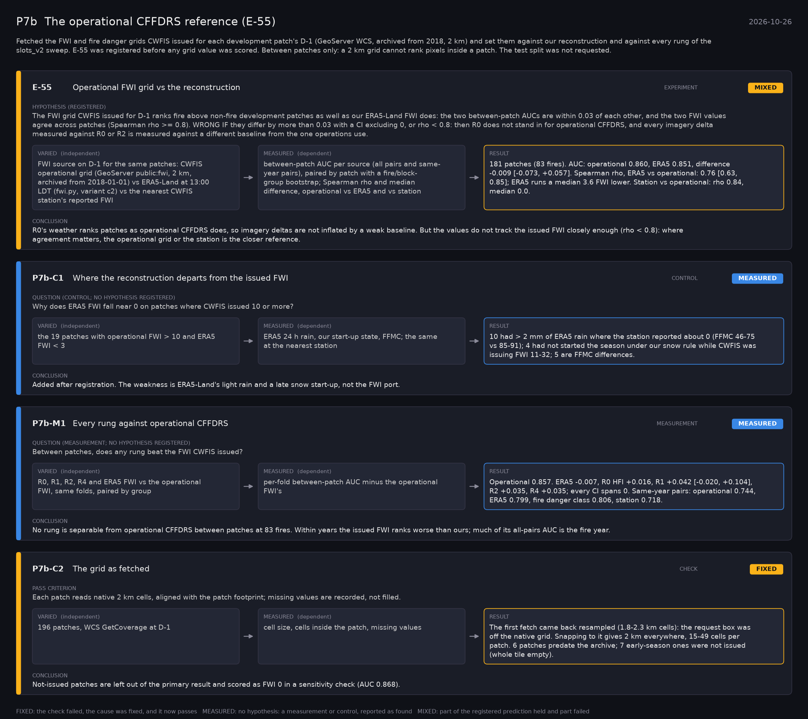

# P7b: The operational CFFDRS reference (E-55) (2026-10-26)

What this phase ran and concluded. Generated by `scripts/make_phase_docs.py` from `src/safari_bands/phases.py`; registered hypotheses are quoted from the register, verbatim. Full results: [README.md](README.md).

Fetched the FWI and fire danger grids CWFIS issued for each development patch's D-1 (GeoServer WCS, archived from 2018, 2 km) and set them against our reconstruction and against every rung of the slots_v2 sweep. E-55 was registered before any grid value was scored. Between patches only: a 2 km grid cannot rank pixels inside a patch. The test split was not requested.

## E-55: Operational FWI grid vs the reconstruction (experiment): **MIXED**

| | |
|---|---|
| Hypothesis (registered) | The FWI grid CWFIS issued for D-1 ranks fire above non-fire development patches as well as our ERA5-Land FWI does: the two between-patch AUCs are within 0.03 of each other, and the two FWI values agree across patches (Spearman rho >= 0.8). WRONG IF they differ by more than 0.03 with a CI excluding 0, or rho < 0.8: then R0 does not stand in for operational CFFDRS, and every imagery delta measured against R0 or R2 is measured against a different baseline from the one operations use. |
| Varied (independent) | FWI source on D-1 for the same patches: CWFIS operational grid (GeoServer public:fwi, 2 km, archived from 2018-01-01) vs ERA5-Land at 13:00 LDT (fwi.py, variant c2) vs the nearest CWFIS station's reported FWI |
| Measured (dependent) | between-patch AUC per source (all pairs and same-year pairs), paired by patch with a fire/block-group bootstrap; Spearman rho and median difference, operational vs ERA5 and vs station |
| Result | 181 patches (83 fires). AUC: operational 0.860, ERA5 0.851, difference -0.009 [-0.073, +0.057]. Spearman rho, ERA5 vs operational: 0.76 [0.63, 0.85]; ERA5 runs a median 3.6 FWI lower. Station vs operational: rho 0.84, median 0.0. |
| Verdict | **MIXED**: part of the registered prediction held and part failed |
| Conclusion | R0's weather ranks patches as operational CFFDRS does, so imagery deltas are not inflated by a weak baseline. But the values do not track the issued FWI closely enough (rho < 0.8): where agreement matters, the operational grid or the station is the closer reference. |

## P7b-C1: Where the reconstruction departs from the issued FWI (control): **MEASURED**

| | |
|---|---|
| Question (control; no hypothesis registered) | Why does ERA5 FWI fall near 0 on patches where CWFIS issued 10 or more? |
| Varied (independent) | the 19 patches with operational FWI > 10 and ERA5 FWI < 3 |
| Measured (dependent) | ERA5 24 h rain, our start-up state, FFMC; the same at the nearest station |
| Result | 10 had > 2 mm of ERA5 rain where the station reported about 0 (FFMC 46-75 vs 85-91); 4 had not started the season under our snow rule while CWFIS was issuing FWI 11-32; 5 are FFMC differences. |
| Verdict | **MEASURED**: no hypothesis: a measurement or control, reported as found |
| Conclusion | Added after registration. The weakness is ERA5-Land's light rain and a late snow start-up, not the FWI port. |

## P7b-M1: Every rung against operational CFFDRS (measurement): **MEASURED**

| | |
|---|---|
| Question (measurement; no hypothesis registered) | Between patches, does any rung beat the FWI CWFIS issued? |
| Varied (independent) | R0, R1, R2, R4 and ERA5 FWI vs the operational FWI, same folds, paired by group |
| Measured (dependent) | per-fold between-patch AUC minus the operational FWI's |
| Result | Operational 0.857. ERA5 -0.007, R0 HFI +0.016, R1 +0.042 [-0.020, +0.104], R2 +0.035, R4 +0.035; every CI spans 0. Same-year pairs: operational 0.744, ERA5 0.799, fire danger class 0.806, station 0.718. |
| Verdict | **MEASURED**: no hypothesis: a measurement or control, reported as found |
| Conclusion | No rung is separable from operational CFFDRS between patches at 83 fires. Within years the issued FWI ranks worse than ours; much of its all-pairs AUC is the fire year. |

## P7b-C2: The grid as fetched (check): **FIXED**

| | |
|---|---|
| Pass criterion | Each patch reads native 2 km cells, aligned with the patch footprint; missing values are recorded, not filled. |
| Varied (independent) | 196 patches, WCS GetCoverage at D-1 |
| Measured (dependent) | cell size, cells inside the patch, missing values |
| Result | The first fetch came back resampled (1.8-2.3 km cells): the request box was off the native grid. Snapping to it gives 2 km everywhere, 15-49 cells per patch. 6 patches predate the archive; 7 early-season ones were not issued (whole tile empty). |
| Verdict | **FIXED**: the check failed, the cause was fixed, and it now passes |
| Conclusion | Not-issued patches are left out of the primary result and scored as FWI 0 in a sensitivity check (AUC 0.868). |
