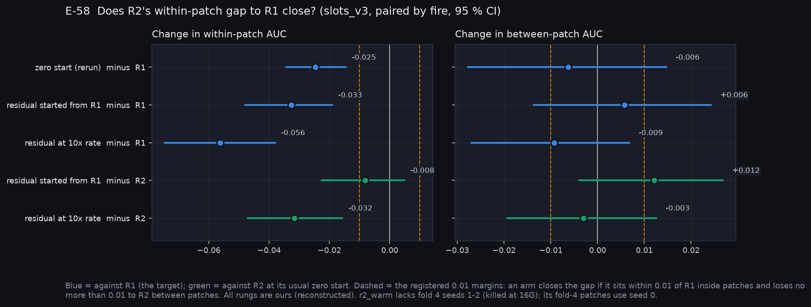
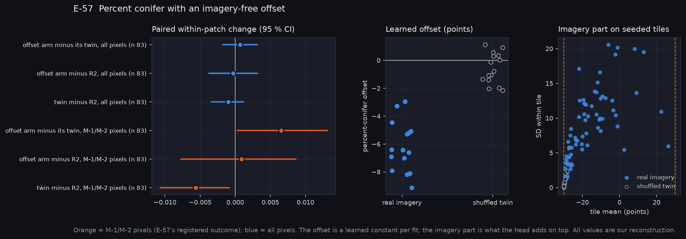
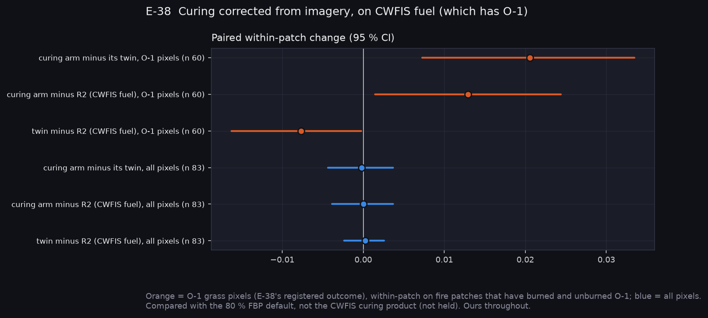
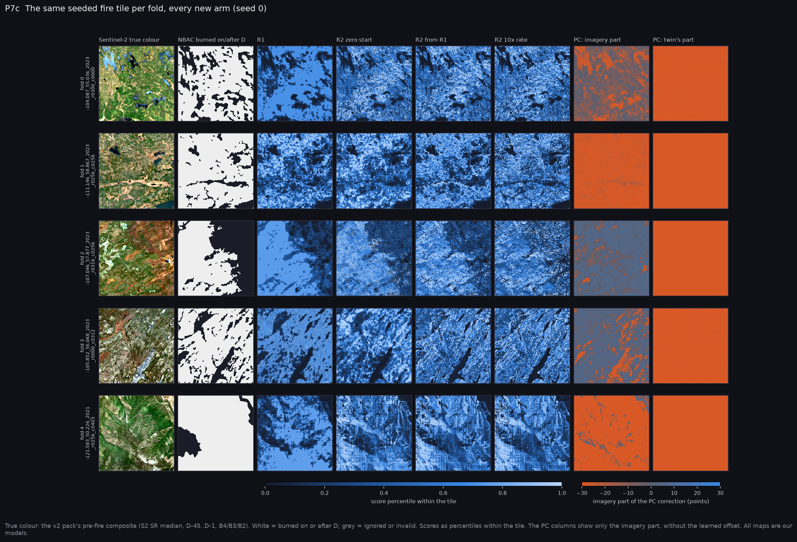

# P7c: Second slot sweep, the Q29 arms (slots_v3, 2026-10-27)

> **Reference key.** Every number here is our reconstruction (R1, R2 and its variants, the R3 arms), unless it is marked **ISSUED by CWFIS**. Within-patch results have no issued counterpart, because CWFIS grids are 2 km.

After P7, you approved three follow-ups (Q29). Each was registered before this sweep ran:

| Arm | Experiment | Configurations |
|---|---|---|
| R2's residual started from a trained R1, or at 10× the learning rate | E-58 | `r2_warm`, `r2_lr10`, with `r1` and `r2` rerun for pairing |
| Percent conifer with an imagery-free learned offset | E-57 | `r3_pc_offset` + twin |
| Curing corrected from imagery on CWFIS fuel, which has O-1 grass | E-38 | `r3_curing_cwfis` + twin, against `r2_cwfis` |

**The sweep.** 9 configurations × 5 folds × 3 seeds, Narval run `slots_v3/20261026-2121`:
- **133 of 135 fits completed.** Two `r2_warm` fits (fold 4, seeds 1–2) were killed for memory at 16G. Their fold-4 patches use seed 0.
- **It reproduces exactly.** R1 and R2, rerun with the same folds and seeds, reproduce the first sweep: R1 0.719/0.886, R2 0.695/0.880 (P7c-C1). Contrasts across the two sweeps are therefore paired.

**At a glance:** [experiments.md](experiments.md). Tables: [tables.md](tables.md). Rebuild with `python scripts/make_results_package.py --phase P7c --run narval_results/slots_v3/20261026-2121`.

## E-58: does R2's gap to R1 close? REFUTED



| Rung (ours) | Within-patch AUC | Between-patch AUC |
|---|---|---|
| R1 | 0.719 | 0.886 |
| R2, zero start | 0.695 | 0.880 |
| R2, residual started from R1 | 0.687 | **0.892** |
| R2, residual at 10× rate | 0.663 | 0.877 |
| *ISSUED by CWFIS: FWI (between patches only)* | — | *0.857* |

- **Neither arm closes the gap inside patches.** Against R1, the warm start is −0.033 [−0.048, −0.019] and the 10× rate −0.056 [−0.075, −0.038], in 0 of 5 folds each. As registered, the gap is the cost of anchoring the score to the physics: about 0.025–0.03 within patches. P12's architecture choice weighs that against keeping the physics.
- **The warm start helps between patches.** It has the best between-patch AUC of any rung (0.892; +0.012 against R2, CI spanning 0). The faster learning rate makes R2 worse.

## E-57: percent conifer with an offset. SUPPORTED as registered, with caveats



- **As registered:**
  - On M-1/M-2 pixels, the offset arm beats its shuffled twin: +0.0065 [+0.0003, +0.0131].
  - Its imagery part varies far more within tiles (SD 6.2 points against the twin's 0.4).
  - So the imagery carries mixedwood information the twin lacks.
- **Caveats:**
  - **It doesn't beat R2.** The offset arm minus R2 on M-1/M-2 is +0.0009 [−0.008, +0.009]. Part of its margin over the twin is the twin doing worse than R2 (−0.0056).
  - **The offset didn't absorb the shift as designed.** It settled at about −6 points, while the imagery part still carries a tile-wide −24 (right panel). The head still spends most of its range on the shift.
- **Net result:** a real signal, too small to matter at 83 fires.

## E-38: curing on CWFIS fuel. PARTIAL



| On O-1 grass pixels (60 fires with burned and unburned O-1) | Within-patch change |
|---|---|
| Curing arm minus its twin | **+0.021 [+0.007, +0.034]** |
| Curing arm minus R2 on the same CWFIS fuel | **+0.013 [+0.002, +0.024]** |
| Twin minus R2 | −0.008 [−0.016, −0.000] |

- **On grass pixels, imagery curing works.** It beats the 80 % FBP default and its shuffled twin. Pooled AUC on O-1 rises from 0.782 to 0.797. This is the first imagery slot whose gain clears both its twin and R2.
- **All pixels: no change (0.000).** O-1 grass is a small share of the landscape.
- **Why PARTIAL.** E-38 registered a comparison with the CWFIS curing product, which we don't hold. That operational half hasn't run.

## The same tiles, every new arm



## Resources (P7c-M1)

| Measure | Median | Max |
|---|---|---|
| Task length (up to 3 fits) | 10 min | 17 min (limit 30) |
| GPU utilisation | 25 % | 47 % |
| Peak GPU memory | 1.1 GB | 1.5 GB of 40 GB |
| Setup per task | 38 s | 75 s |

Changes in `Fire_Risk_FW`, committed with this note:
- **Memory:** `--mem` raised from 16G to 32G.
- **Warm start:** R1 is freed before R2 trains.
- **Monitor:** records the job's own memory (`job_mem_MiB`, from its cgroup). The old RAM column was the whole node.

To rerun the two missing fits:

```bash
SUBMIT=1 EXP_NAME=slots_v3 RUN_ID=20261026-2121 SKIP_DONE=1 CONFIGS=r2_warm bash scripts/shell/sweep_slots.sh
```

The GPU is mostly idle (25 %, 1.5 GB), so one test sub-array on an A100 MIG slice could cut the request. A MIG slice has its own CPU limit, though, and these jobs are input-bound, so it needs testing first.
