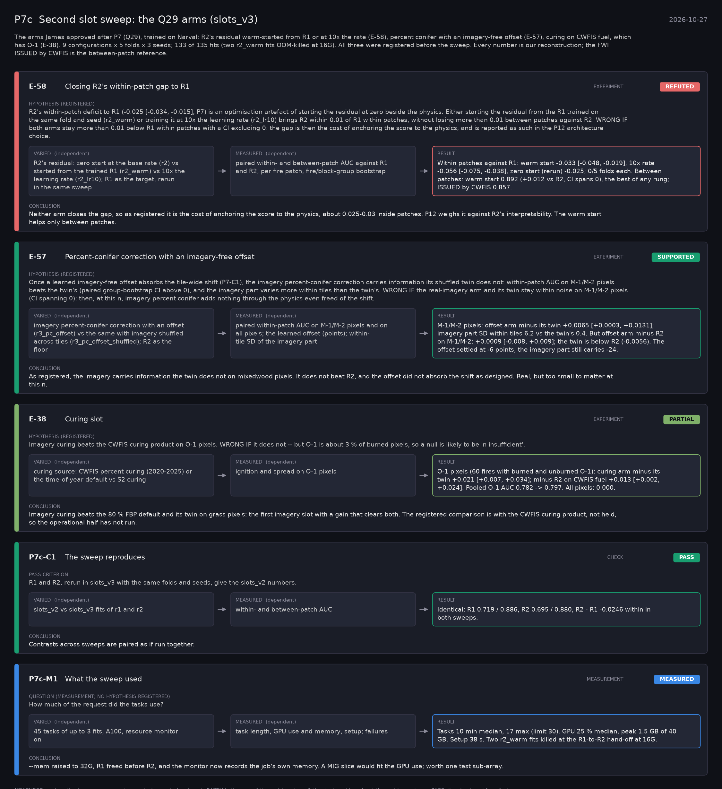

# P7c: Second slot sweep: the Q29 arms (slots_v3) (2026-10-27)

What this phase ran and concluded. Generated by `scripts/make_phase_docs.py` from `src/safari_bands/phases.py`; registered hypotheses are quoted from the register, verbatim. Full results: [README.md](README.md).

The arms James approved after P7 (Q29), trained on Narval: R2's residual warm-started from R1 or at 10x the rate (E-58), percent conifer with an imagery-free offset (E-57), curing on CWFIS fuel, which has O-1 (E-38). 9 configurations x 5 folds x 3 seeds; 133 of 135 fits (two r2_warm fits OOM-killed at 16G). All three were registered before the sweep. Every number is our reconstruction; the FWI ISSUED by CWFIS is the between-patch reference.

## E-58: Closing R2's within-patch gap to R1 (experiment): **REFUTED**

| | |
|---|---|
| Hypothesis (registered) | R2's within-patch deficit to R1 (-0.025 [-0.034, -0.015], P7) is an optimisation artefact of starting the residual at zero beside the physics. Either starting the residual from the R1 trained on the same fold and seed (r2_warm) or training it at 10x the learning rate (r2_lr10) brings R2 within 0.01 of R1 within patches, without losing more than 0.01 between patches against R2. WRONG IF both arms stay more than 0.01 below R1 within patches with a CI excluding 0: the gap is then the cost of anchoring the score to the physics, and is reported as such in the P12 architecture choice. |
| Varied (independent) | R2's residual: zero start at the base rate (r2) vs started from the trained R1 (r2_warm) vs 10x the learning rate (r2_lr10); R1 as the target, rerun in the same sweep |
| Measured (dependent) | paired within- and between-patch AUC against R1 and R2, per fire patch, fire/block-group bootstrap |
| Result | Within patches against R1: warm start -0.033 [-0.048, -0.019], 10x rate -0.056 [-0.075, -0.038], zero start (rerun) -0.025; 0/5 folds each. Between patches: warm start 0.892 (+0.012 vs R2, CI spans 0), the best of any rung; ISSUED by CWFIS 0.857. |
| Verdict | **REFUTED**: the registered prediction failed |
| Conclusion | Neither arm closes the gap, so as registered it is the cost of anchoring the score to the physics, about 0.025-0.03 inside patches. P12 weighs it against R2's interpretability. The warm start helps only between patches. |

## E-57: Percent-conifer correction with an imagery-free offset (experiment): **SUPPORTED**

| | |
|---|---|
| Hypothesis (registered) | Once a learned imagery-free offset absorbs the tile-wide shift (P7-C1), the imagery percent-conifer correction carries information its shuffled twin does not: within-patch AUC on M-1/M-2 pixels beats the twin's (paired group-bootstrap CI above 0), and the imagery part varies more within tiles than the twin's. WRONG IF the real-imagery arm and its twin stay within noise on M-1/M-2 pixels (CI spanning 0): then, at this n, imagery percent conifer adds nothing through the physics even freed of the shift. |
| Varied (independent) | imagery percent-conifer correction with an offset (r3_pc_offset) vs the same with imagery shuffled across tiles (r3_pc_offset_shuffled); R2 as the floor |
| Measured (dependent) | paired within-patch AUC on M-1/M-2 pixels and on all pixels; the learned offset (points); within-tile SD of the imagery part |
| Result | M-1/M-2 pixels: offset arm minus its twin +0.0065 [+0.0003, +0.0131]; imagery part SD within tiles 6.2 vs the twin's 0.4. But offset arm minus R2 on M-1/M-2: +0.0009 [-0.008, +0.009]; the twin is below R2 (-0.0056). The offset settled at -6 points; the imagery part still carries -24. |
| Verdict | **SUPPORTED**: the registered prediction held |
| Conclusion | As registered, the imagery carries information the twin does not on mixedwood pixels. It does not beat R2, and the offset did not absorb the shift as designed. Real, but too small to matter at this n. |

## E-38: Curing slot (experiment): **PARTIAL**

| | |
|---|---|
| Hypothesis (registered) | Imagery curing beats the CWFIS curing product on O-1 pixels. WRONG IF it does not -- but O-1 is about 3 % of burned pixels, so a null is likely to be 'n insufficient'. |
| Varied (independent) | curing source: CWFIS percent curing (2020-2025) or the time-of-year default vs S2 curing |
| Measured (dependent) | ignition and spread on O-1 pixels |
| Result | O-1 pixels (60 fires with burned and unburned O-1): curing arm minus its twin +0.021 [+0.007, +0.034]; minus R2 on CWFIS fuel +0.013 [+0.002, +0.024]. Pooled O-1 AUC 0.782 -> 0.797. All pixels: 0.000. |
| Verdict | **PARTIAL**: the part of the registered prediction that could run held; the rest has not run |
| Conclusion | Imagery curing beats the 80 % FBP default and its twin on grass pixels: the first imagery slot with a gain that clears both. The registered comparison is with the CWFIS curing product, not held, so the operational half has not run. |

## P7c-C1: The sweep reproduces (check): **PASS**

| | |
|---|---|
| Pass criterion | R1 and R2, rerun in slots_v3 with the same folds and seeds, give the slots_v2 numbers. |
| Varied (independent) | slots_v2 vs slots_v3 fits of r1 and r2 |
| Measured (dependent) | within- and between-patch AUC |
| Result | Identical: R1 0.719 / 0.886, R2 0.695 / 0.880, R2 - R1 -0.0246 within in both sweeps. |
| Verdict | **PASS**: the check met its criterion |
| Conclusion | Contrasts across sweeps are paired as if run together. |

## P7c-M1: What the sweep used (measurement): **MEASURED**

| | |
|---|---|
| Question (measurement; no hypothesis registered) | How much of the request did the tasks use? |
| Varied (independent) | 45 tasks of up to 3 fits, A100, resource monitor on |
| Measured (dependent) | task length, GPU use and memory, setup; failures |
| Result | Tasks 10 min median, 17 max (limit 30). GPU 25 % median, peak 1.5 GB of 40 GB. Setup 38 s. Two r2_warm fits killed at the R1-to-R2 hand-off at 16G. |
| Verdict | **MEASURED**: no hypothesis: a measurement or control, reported as found |
| Conclusion | --mem raised to 32G, R1 freed before R2, and the monitor now records the job's own memory. A MIG slice would fit the GPU use; worth one test sub-array. |
