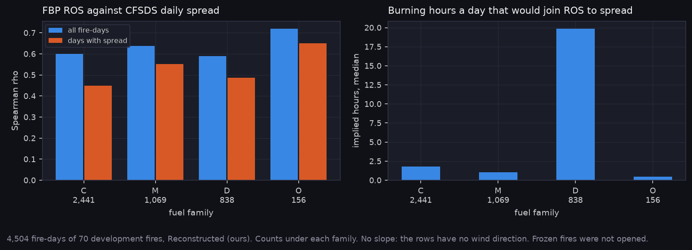

# P8a: Stage B, FBP spread against CFSDS (E-41)

Physics only, nothing trained, on the development fires. The frozen test fires were not opened. All values are Reconstructed (ours). Design and limits are in A-46.

Generated with:

```bash
cd ../Fire_Risk_Model
python scripts/python/build_spread_dataset.py
python scripts/python/eval_spread_r0.py --out ../Fire_Risk_Statistics/runs/20261103-e41_spread_r0
cd ../Fire_Risk_Statistics
python scripts/make_results_package.py --phase P8a --run runs/20261103-e41_spread_r0
python scripts/make_phase_docs.py --phase P8a
```

## What it found



- **On development fires, E-41's falsifier doesn't fire.** FBP ROS tracks daily spread: Spearman 0.54 [0.49, 0.59] over 4,504 fire-days of 70 fires, and 0.54 within a fire.
- **Days with no spread help that figure.** 38 % of fire-days have zero spread, and they tend to be low-danger days. On days with spread, rho is 0.39 [0.34, 0.44].
- **The scale doesn't hold across fuels.** Joining ROS to daily spread takes a median 1.8 burning hours in conifer, 1.1 in mixedwood, and about 20 in deciduous. That last figure means FBP badly under-predicts deciduous spread here, or the single leaf state is wrong for long fires.

## Limits

- **Most rows use an older fuel layer.** 4,120 of 4,925 rows lie off their patch and take the CWFIS 2019 layer.
- **E-42 is smaller than the row count.** Only 805 fire-days lie on a patch with imagery. P0 counted fires, not fire-days.
- **No slope, one leaf state.** See A-46.

<!-- qual:start -->
## Qualitative view per experiment

- **E-41** Spread R0 (CFSDS) (fire progression): [qual_E-41_progression.png](qual_E-41_progression.png)
<!-- qual:end -->
