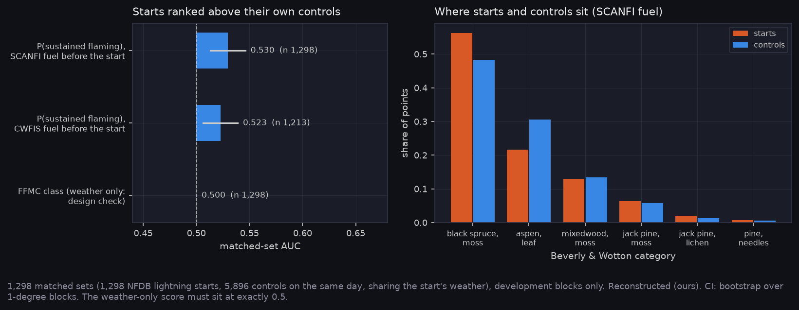

# P9: Stage C, CFFDRS ignition R0 on lightning starts (E-44)

This is physics only; nothing is trained. It covers NFDB lightning starts in 2017-2024, each against controls drawn on the same day nearby. A first pass on 2021-2024 (run `20261103-2325_ignition_r0`, kept) was decided before any score; this note reports all years and compares the two periods. The frozen test blocks and all of 2025 were not opened. All values are Reconstructed (ours). Design and limits are in A-46.

Generated with:

```bash
cd ../Fire_Risk_Model
python scripts/python/build_ignition_dataset.py --stage weather          # Earth Engine, one fetch per start
python scripts/python/build_dated_weather.py --patch-dir data/ignition_v1/patches --only leaf
python scripts/python/attach_fuel_vintages.py --vintage 2014b --layer ... --patch-dir data/ignition_v1/patches
python scripts/python/attach_fuel_vintages.py --vintage 2019 --layer ... --patch-dir data/ignition_v1/patches
python scripts/python/build_ignition_dataset.py --stage scanfi --steps 2020
python scripts/python/build_ignition_dataset.py --stage scanfi --steps 2015   # streams from NRCan, ~8 h; rerun retries failed reads
python scripts/python/build_ignition_dataset.py --stage filter
python scripts/python/eval_ignition_r0.py --out ../Fire_Risk_Statistics/runs/20261104-0330_ignition_r0
python scripts/python/export_qual_views.py --only p9_sets --ignition-run ../Fire_Risk_Statistics/runs/20261104-0330_ignition_r0 --out ../Fire_Risk_Statistics/runs/20261103-qual_views
cd ../Fire_Risk_Statistics
python scripts/make_results_package.py --phase P9 --run runs/20261104-0330_ignition_r0
python scripts/make_experiment_qual.py --only E-44
python scripts/make_phase_docs.py --phase P9
```

## What it found



- **The design holds.** A weather-only score (the FFMC class) ranks starts against their own controls at exactly 0.500 over 1,298 sets. Every control carries its start's weather, so inside a set only fuel and leaf state can differ.
- **E-44's falsifier doesn't fire, but only just.**
  - With SCANFI fuel from the step before the start, Beverly & Wotton (2007) P(sustained flaming) ranks starts above their controls at a matched-set AUC of 0.530 [0.513, 0.546].
  - With the CWFIS layer before the start, it reaches 0.523 [0.506, 0.539], on 1,213 sets.
  - Both CIs clear 0.5 by under 0.02.
- **The edge is conifer over aspen.**
  - Starts sit on black spruce/moss more often than controls do (56 % vs 48 %), where mean P is 0.50.
  - They sit on aspen less often (22 % vs 31 %), where mean P is 0.13.
  - Other categories hold too few points to matter.
- **The two periods agree for SCANFI, not for CWFIS.**

  | period | sets | SCANFI | CWFIS |
  |---|---|---|---|
  | 2017-2020 (SCANFI 2015; CWFIS 2014b, 2019 for 2020) | 538 | 0.536 [0.511, 0.561] | 0.506 [0.484, 0.530] (507) |
  | 2021-2024 (SCANFI 2020; CWFIS 2019), first pass | 758 | 0.526 [0.507, 0.545] | 0.535 [0.512, 0.558] (704) |

  The CWFIS arm's edge in 2021-2024 doesn't carry back to 2017-2020, so neither fuel source is read as better.
- **The CWFIS arm loses sets.** It drops 85 sets whose start sits on a code with no Beverly & Wotton category, and spreads points over more categories, including pine needles and grass.

## Limits

- **Filter losses.** Of 1,499 drawn starts, 44 have coarse coordinates, 97 burned before D, 36 sit on non-fuel, 20 have no imagery and 4 lost every control. 1,298 sets and 7,194 points remain.
- **Start positions are coarser than control positions.**
  - NFDB coordinates are reported values, often rounded, while controls are exact.
  - Starts with fewer than 3 decimals are dropped (44). The rest still carry tens of metres of error.
  - That error pulls the AUC towards 0.5.
- **R0 has one lever.** With weather shared, P(sustained flaming) varies only by fuel category and, for grass, leaf state. In-stand moisture by canopy closure (Wotton & Beverly 2007) and lightning holdover (Wotton & Wheatley 2025) are waiting on coefficients (Q26). Holdover is constant inside a set in any case.
- **Strike density is not held fixed** (A-28). A control may have had no strike at all, so "no fire" there doesn't mean "not receptive". Everything here is read as where fires took hold among nearby ground on the same day, not as receptivity alone.

## What comes next

E-45 asks whether imagery slots beat this floor: closure, green-up, fuel type and their shuffled twins. The matched sets, chips and sidecars are ready. It needs a pack for the slot network, built the same way as the cohort pack, and training on Nibi.

<!-- qual:start -->
## Qualitative view per experiment

- **E-44** Ignition R0 (matched sets): [qual_E-44_sets.png](qual_E-44_sets.png)
- **E-45** Ignition slot value (none): PENDING: the ignition sweep has not run (A-48). The view will be E-44's matched sets with the R4 map and its shuffled twin's.
<!-- qual:end -->
