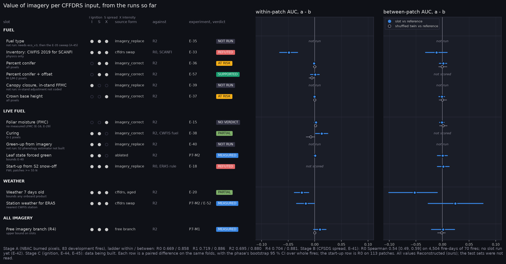

# Value map: what each CFFDRS input slot changed

Generated by `scripts/make_value_map.py` from the phase summaries; do not edit. Paired differences a - b in AUC with the phase's bootstrap 95 % CI over whole fires. All values Reconstructed (ours).

| group | slot | feeds | source form | against | experiment | verdict | within-patch | between-patch | shuffled twin, within | note |
|---|---|---|---|---|---|---|---|---|---|---|
| Fuel | Fuel type | ISX | imagery_replace | R2 | E-35 | NOT RUN | not run |  |  | not run: needs eco_v3, then the E-35 sweep (A-45) |
| Fuel | Inventory: CWFIS 2019 for SCANFI | ISX | cffdrs swap | R0, SCANFI | E-33 | REFUTED | -0.0484 [-0.0659, -0.0320] | -0.0112 [-0.0318, +0.0088] |  | physics only |
| Fuel | Percent conifer | SX | imagery_correct | R2 | E-36 | AT RISK | -0.0012 [-0.0035, +0.0009] | +0.0014 [-0.0061, +0.0080] | -0.0002 [-0.0029, +0.0028] | all pixels |
| Fuel | Percent conifer + offset | SX | imagery_correct | R2 | E-57 | SUPPORTED | +0.0009 [-0.0077, +0.0086] |  | -0.0056 [-0.0107, -0.0008] | M-1/M-2 pixels |
| Fuel | Canopy closure, in-stand FFMC | I | imagery_replace | R2 | E-39 | NOT RUN | not run |  |  | not run: in-stand adjustment not coded |
| Fuel | Crown base height | X | imagery_correct | R2 | E-37 | AT RISK | -0.0005 [-0.0029, +0.0017] | -0.0011 [-0.0069, +0.0039] | +0.0000 [-0.0024, +0.0024] | all pixels |
| Live fuel | Foliar moisture (FMC) | X | imagery_correct | R2 | E-15 | NO VERDICT | +0.0022 [-0.0010, +0.0053] | -0.0008 [-0.0055, +0.0033] | +0.0015 [-0.0008, +0.0036] | no measured LFMC (E-16, E-29) |
| Live fuel | Curing | IS | imagery_correct | R2, CWFIS fuel | E-38 | PARTIAL | +0.0129 [+0.0015, +0.0244] |  | -0.0077 [-0.0163, -0.0002] | O-1 pixels |
| Live fuel | Green-up from imagery | IS | imagery_replace | R2 | E-40 | NOT RUN | not run |  |  | not run: S2 phenology estimator not built |
| Live fuel | Leaf state forced green | IS | ablated | R2 | P7-M2 | MEASURED | +0.0008 [-0.0022, +0.0037] | +0.0003 [-0.0097, +0.0092] |  | bounds E-40 |
| Live fuel | Start-up from S2 snow-off | ISX | imagery_replace | R0, ERA5 rule | E-18 | REFUTED |  | +0.0016 [-0.0094, +0.0125] |  | FWI, patches >= 55 N |
| Weather | Weather 7 days old | ISX | cffdrs, aged | R2 | E-20 | PARTIAL | -0.0244 [-0.0385, -0.0112] | -0.0524 [-0.1008, -0.0097] |  | bounds any onboard product |
| Weather | Station weather for ERA5 | ISX | cffdrs swap | R2 | P7-M2, E-52 | MEASURED | -0.0171 [-0.0341, -0.0007] | +0.0240 [-0.0269, +0.0763] |  | nearest CWFIS station |
| All imagery | Free imagery branch (R4) | ISX | free branch | R2 | P7-M1 | MEASURED | +0.0096 [-0.0020, +0.0213] | +0.0012 [-0.0208, +0.0227] | -0.0000 [-0.0023, +0.0023] | upper bound on slots |

Feeds: I ignition, S spread, X intensity.
